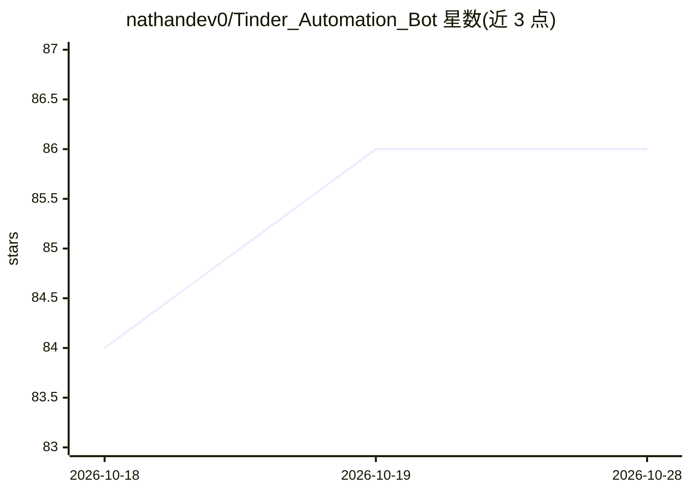

# nathandev0/Tinder_Automation_Bot

⭐ 86 · Python · 推送 2026-10-28 · [GitHub](https://github.com/nathandev0/Tinder_Automation_Bot) · [官网](https://t.me/nathandev0) · 个人维护

**基于 Appium 的 Tinder 自动注册与滑动机器人（iOS 真机）**

运行于 iOS 真机的 Tinder 自动化工具：通过 Appium 驱动真实设备完成账号自动创建（可自定义资料字段）、自动滑卡并输出统计、token 提取导出至 Google 表格、图片清理、影子封禁检测、GPS 定位伪造、IP 轮换与越狱检测绕过；配套 Crane 容器与 App 克隆的自动创建删除。附加功能包括任务调度管理系统、基于人类行为建模的反检测系统、多家短信验证服务商（SMSDaisy/SMSPool/SMSActivate）与多国号码支持。支持 Windows/macOS、多线程不限设备数。README 未给出安装与运行步骤，仅列出功能与联系方式。

## 筛选速览

| 维度 | 判定 | 备注 |
|---|---|---|
| AI 角色 | `ai-enhanced` | 去掉 AI 部分产品仍成立 |
| 许可风险 | `none` | — |
| 部署形态 | `None` |  |
| 模型依赖 | — | README 未给出锁定关系 |
| 硬件要求 | — | 无带数字的原话,不猜 |
| 安装摩擦 | `low` | 无编译、无系统依赖或容器化 |
| 成熟度 | — | 结构信号不足 |

## 能力要点

- Appium 驱动 iOS 真机进行账号创建与滑卡
- 每容器/克隆独立 GPS 坐标与 IP 地址
- 支持 3 家短信验证服务商与多国号码
- 多线程、不限设备数量，兼容 iPhone 8 及以后旧机型

## 适用场景

- 批量创建并管理 Tinder 账号
- 自动滑卡并查看统计数据
- 需要独立 IP 与 GPS 定位的账号运营

## 场景标签

`GUI 自动化` · 领域:效率与自动化

## 证据(README 行号)

> L4:  Appium -based automated Tinder account creation and swiping on real devices .
> L23: - **2) Anti-bot system** (human behavior modeling)

## 星数曲线

2026-10-18 84 → 2026-10-28 86（+2）

---
*卡片 v1 · prompt 1.4 · 生成 2026-10-24 · 置信度 low · 依据 README sha `95561e2d531e` · [字段定义](../../DATASET.md)*
