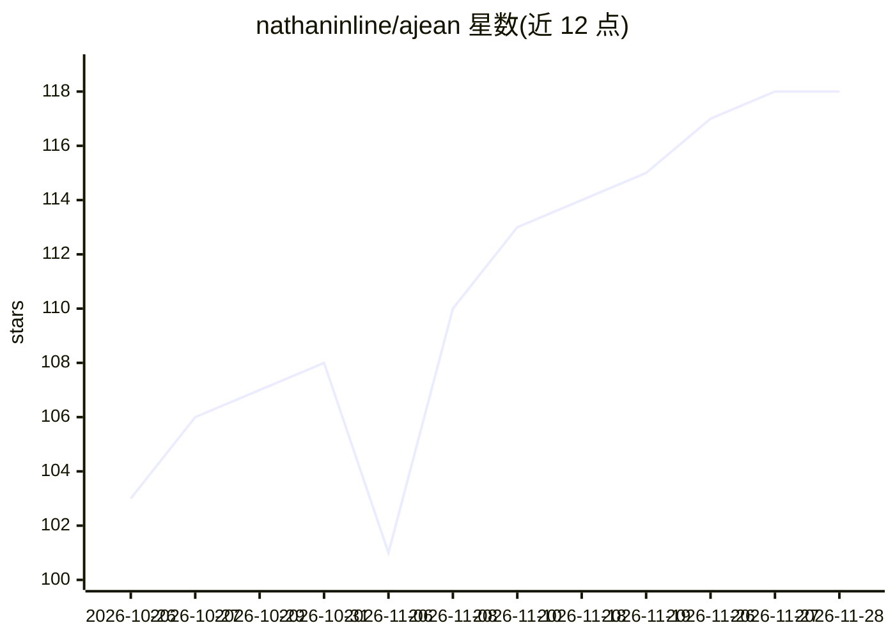

# nathaninline/ajean

⭐ 118 · Go · MIT · 推送 2026-11-21 · [GitHub](https://github.com/nathaninline/ajean) · [官网](https://ajean.app) · 个人维护

**单文件自托管 AI 助手：把家用电脑变成可远程访问的助手**

一个单可执行程序，将带显卡（或纯 CPU）的电脑变成完整 AI 助手：聊天界面、项目记忆、agent 工具、网页访问、定时任务与手机端访问，数据全程留在本地。模型运行在 llama.cpp 上，由 AJEAN 自动安装并保持更新（预编译版约两分钟，或按机器编译 CUDA/ROCm/Metal/Vulkan/CPU 后端）；也支持任意 OpenAI 兼容 API、自启动命令及 Modal GPU 云。无 Docker、无 Python 依赖，支持 MCP 服务器、浏览器控制与 OpenAI 兼容端点输出。

## 筛选速览

| 维度 | 判定 | 备注 |
|---|---|---|
| AI 角色 | `ai-native` | 本体是模型或模型工具 |
| 许可风险 | `permissive` | MIT |
| 部署形态 | `desktop` | 安装包/桌面程序 |
| 模型依赖 | local-ok | 支持本地模型 |
| 硬件要求 | — | 无带数字的原话,不猜 |
| 安装摩擦 | `medium` | 含编译或系统依赖之一 |
| 成熟度 | — | 结构信号不足 |

## 能力要点

- 单文件、无依赖：无需 Docker/Python，Linux/Windows/macOS 三平台
- 自动安装与更新 llama.cpp 引擎（预编译/本机编译/自定义 fork 四档）
- 项目级记忆、tracker、定时任务与 Chrome/Chromium/Edge 浏览器控制
- ajean.link 中继远程访问：出站连接免开端口，端到端加密

## 适用场景

- 在家用旧电脑/游戏 PC 搭建私人 AI 助手，数据不出本机
- 通过手机与电脑实时同步同一批对话
- 给自动化脚本配一个本地 OpenAI 兼容模型端点
- 让 AI 按计划自动执行收邮件、汇总新闻等定时任务

## 场景标签

`AI 助手` `浏览器自动化` · 领域:效率与自动化

## 证据(README 行号)

> L9: **Run your own AI at home.** AJEAN is a single program that turns a computer with a graphics card (or a plain CPU) i
> L11: AJEAN handles everything around the model. The model itself runs on llama.cpp, which AJEAN installs and keeps up to
> L13: - **One file, no dependencies.** No Docker, no Python, no runtime to install. Linux, Windows and macOS.

## 星数曲线

2026-10-26 103 → 2026-11-28 118（+15）

---
*卡片 v1 · prompt 1.4 · 生成 2026-11-28 · 置信度 high · 依据 README sha `0b1ec80a1961` · [字段定义](../../DATASET.md)*
