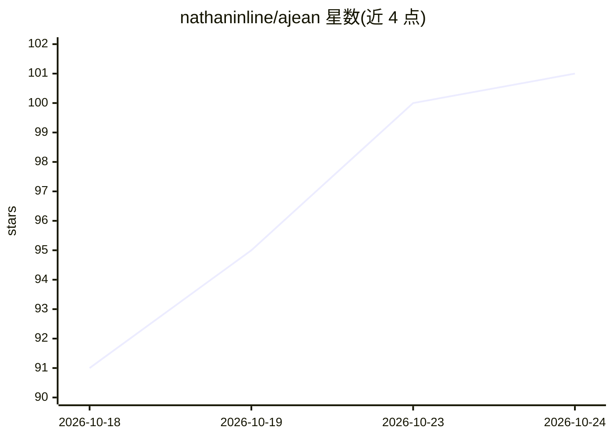

# nathaninline/ajean

⭐ 101 · Go · MIT · 推送 2026-10-23 · [GitHub](https://github.com/nathaninline/ajean) · [官网](https://ajean.app) · 个人维护

**单文件本地 AI 助手：在家用电脑上运行带记忆与工具的聊天助手**

以单个二进制程序把带显卡或纯 CPU 的电脑变为自托管的 AI 助手：内置 Web 聊天界面、按项目隔离的持久记忆、Web 搜索与读取、浏览器控制（经无障碍树定位元素）、MCP 服务器接入、定时任务与 OpenAI 兼容端点。模型本身运行在 llama.cpp 上，由程序负责安装与更新（预构建或按机器编译）。面向个人用户，支持 Linux/macOS/Windows，可选付费 ajean.link 中继实现端到端加密的远程访问。

## 筛选速览

| 维度 | 判定 | 备注 |
|---|---|---|
| AI 角色 | `ai-native` | 本体是模型或模型工具 |
| 许可风险 | `permissive` | MIT |
| 部署形态 | `desktop` | 安装包/桌面程序 |
| 模型依赖 | local-ok | 支持本地模型 |
| 硬件要求 | — | 无带数字的原话,不猜 |
| 安装摩擦 | `medium` | 含编译或系统依赖之一 |
| 成熟度 | — | 结构信号不足 |

## 能力要点

- 单二进制发布，无需 Docker/Python，支持 Linux/macOS/Windows（含 ARM）
- 项目级记忆、Trackers 与四种聊天模式（Quick/Project/Jean/Base）
- MCP 服务器接入（stdio/HTTP，兼容 Claude Desktop 配置）与定时任务
- llama.cpp 引擎由程序安装更新，模型可跑本地、外部 API 或 Modal GPU 云

## 适用场景

- 在家用电脑或服务器上自托管一个带记忆的个人 AI 助手
- 让 AI 按计划自动执行任务（查邮箱、汇总新闻、跟踪数据）
- 把本地模型以 OpenAI 兼容端点提供给第三方应用
- 手机上继续访问与电脑同步的对话与记忆

## 场景标签

`AI 助手` `聊天机器人` `工作流自动化` · 领域:效率与自动化

## 证据(README 行号)

> L7: **Run your own AI at home.** AJEAN is a single program that turns a computer with a graphics card (or a plain CPU) i
> L12: - **An assistant, not just a model.** It remembers, organizes work into projects, runs commands, reads the web, dri

## 星数曲线

2026-10-18 91 → 2026-10-24 101（+10）

---
*卡片 v1 · prompt 1.4 · 生成 2026-10-23 · 置信度 high · 依据 README sha `a0213bc4f261` · [字段定义](../../DATASET.md)*
