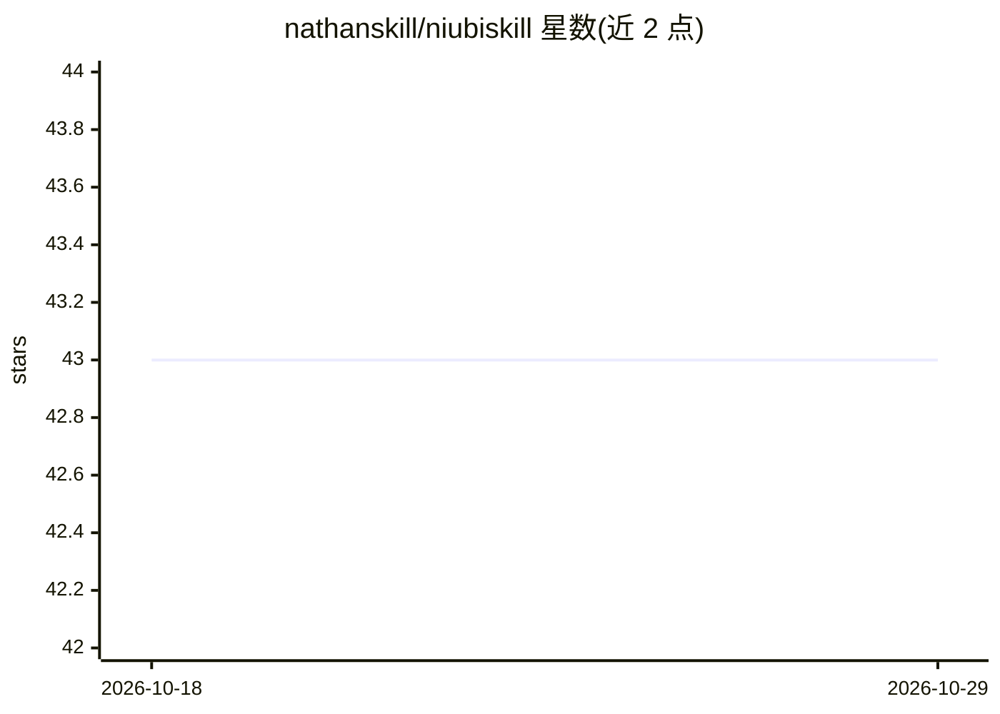

# nathanskill/niubiskill

⭐ 43 · Python · Apache-2.0 · 推送 2026-10-25 · [GitHub](https://github.com/nathanskill/niubiskill) · 个人维护 · 中文 README

**面向开发者的变现决策 Skill：先判断是否接近收入再投入**

NIUBI Skill 是一个用于 Claude Code 的 agent 技能（SKILL 格式），由个人维护者 Nathan 开发。功能上分两部分：一是判断当前的开发、内容或投入是否产生商业证据，在缺少真实买方阻塞时可叫停不产生付费信号的生产；二是从最多 3 个价值捕获逻辑中按权限可做、买方证据、离收钱距离、七天可验证等条件选出 1 个最可行的获利路径，输出本周动作与七天验证事件。README 声明不保证赚钱、不编造价格与案例。通过 npx skills add 安装，以对话方式调用。

## 筛选速览

| 维度 | 判定 | 备注 |
|---|---|---|
| AI 角色 | `ai-native` | 本体是模型或模型工具 |
| 许可风险 | `permissive` | Apache-2.0 |
| 部署形态 | `library` | 以包/库形式分发 |
| 模型依赖 | — | README 未给出锁定关系 |
| 硬件要求 | — | 无带数字的原话,不猜 |
| 安装摩擦 | `low` | 无编译、无系统依赖或容器化 |
| 成熟度 | — | 结构信号不足 |

## 能力要点

- 叫停不产生商业证据的开发与投入，需真实买方阻塞才允许继续
- 按四层条件从最多 3 个价值捕获逻辑中筛出 1 个获利路径
- 输出本周动作、可直接使用的材料与七天验证事件
- 将商业反馈分为收钱/前进/非结果三层证据，只推进商业链第一个断点

## 适用场景

- 继续开发新功能或追加投入前，先验证是否接近收入
- 有流量或用户但没收入时，找出最近的赚钱点
- 决定本周先停什么、只做引流/成交/暂停

## 场景标签

`提示工程` · 领域:Agent 开发

## 证据(README 行号)

> L9: 在你继续开发、继续发内容或继续投入之前，它先判断你正在做的事情是否真的接近收入，再找出一个离真实收钱最近的赚钱点。
> L14: npx -y skills add nathanskill/niubiskill -g --all

## 星数曲线

2026-10-18 43 → 2026-10-29 43（+0）

---
*卡片 v1 · prompt 1.4 · 生成 2026-10-25 · 置信度 high · 依据 README sha `55ddd0d18a41` · [字段定义](../../DATASET.md)*
