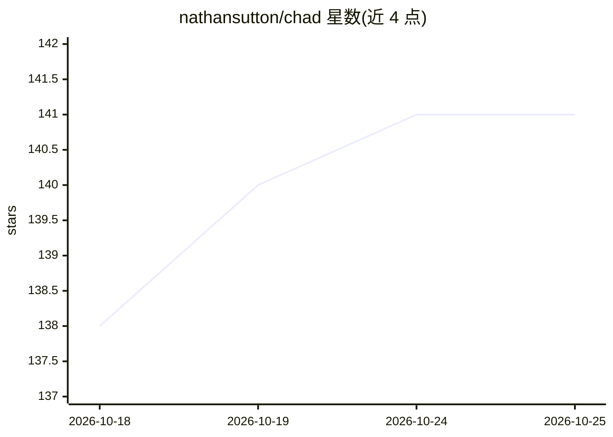

# nathansutton/chad

⭐ 143 · Python · MIT · 推送 2026-10-23 · [GitHub](https://github.com/nathansutton/chad) · 个人维护

**在 Apple Silicon Mac 上本地运行的编程 Agent（MLX + 27B 模型）**

面向 MacBook Pro 用户的本地编程 Agent：基于 MLX 在 Apple Silicon 上运行单个 Qwen 3.8 27B 模型（Unsloth Q3 GGUF 权重），无需 API key，首次运行下载约 14 GB 模型。Agent 循环直接持有后端进程而非走 /completions 端点，配合自定义 kernel 与 dflash2 drafter 实现约 50 tokens/s 生成。定位为'监督下的编程'：自动读代码、改代码、跑测试直到通过。限制：需要 24 GB 内存的 Apple Silicon 设备，不支持自选模型。

## 筛选速览

| 维度 | 判定 | 备注 |
|---|---|---|
| AI 角色 | `ai-native` | 本体是模型或模型工具 |
| 许可风险 | `permissive` | MIT |
| 部署形态 | `library` | 以包/库形式分发 |
| 模型依赖 | — | README 未给出锁定关系 |
| 硬件要求 | — | 无带数字的原话,不猜 |
| 安装摩擦 | `low` | 无编译、无系统依赖或容器化 |
| 成熟度 | — | 结构信号不足 |

## 能力要点

- 基于 MLX 全本地运行，单模型（Qwen 27B）无 API key
- Agent 循环直接管理后端进程，KV cache 更稳定
- 提供 uvx 一键运行与离线冒烟测试（4 个修复任务）
- 支持 MCP servers、Agent Skills、plan mode 等配置

## 适用场景

- 在 MacBook Pro 上离线跑通失败测试的自动修复流程
- 不想付 API 费用、数据不出本地的辅助编程
- 让 Agent 在监督下完成读码、改码、跑测试的闭环

## 场景标签

`编码 Agent` · 领域:编码与开发

## 证据(README 行号)

> L10: chad is a coding agent that runs entirely on an Apple Silicon Mac via
> L21: chad fixing a failing test end to end: reason, read, edit, run pytest, confirm green, all on a local model
> L32: **1 capable model**. `Qwen 3.8 27B`. This isn't the frontier, but you probably aren't solving frontier problems. Fo

## 星数曲线

2026-10-18 138 → 2026-10-25 141（+3）

---
*卡片 v1 · prompt 1.4 · 生成 2026-10-22 · 置信度 high · 依据 README sha `e3fd95594246` · [字段定义](../../DATASET.md)*
