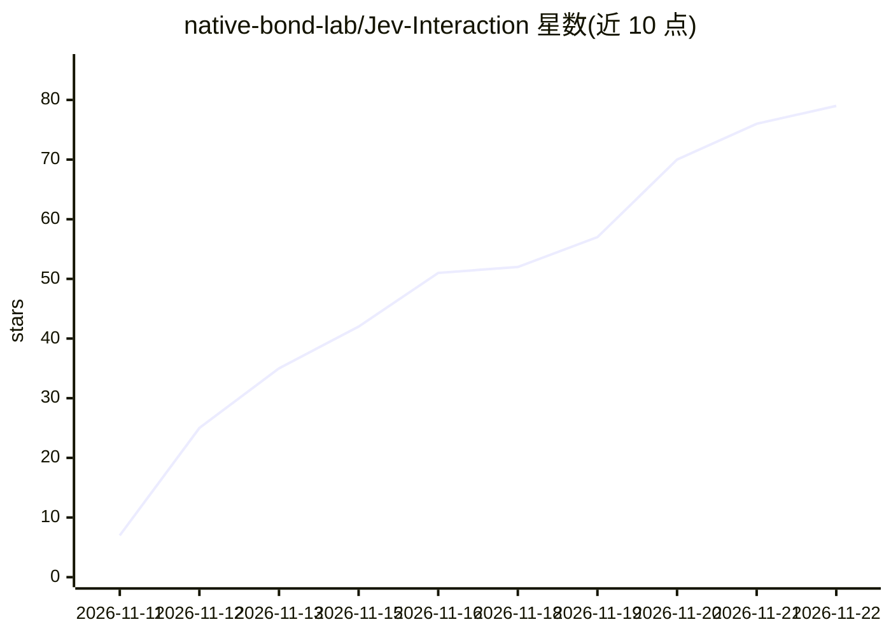

# native-bond-lab/Jev-Interaction

⭐ 79 · Python · Apache-2.0 · 推送 2026-11-20 · [GitHub](https://github.com/native-bond-lab/Jev-Interaction) · [官网](https://pupunpu-jev-interaction.hf.space/) · 组织维护 · 中文 README

**全双工语音交互框架：用自然语言决策控制轮次切换**

由 Native Bond Lab（消费语音产品背后的应用研究实验室）开源的全双工语音交互框架。架构为级联式：语音识别 → Jev 快速决策器 → 任意语言模型 → 任意语音合成。核心机制是把每个轮次时刻（用户停顿、抢话、静默等）写成可读的多选题，由 Jev 在数十毫秒内给出各选项概率，再由策略转为动作；任务画像是一页文本，零训练即可切换 companion/support/tutor 等角色。语言模型接任意 OpenAI 兼容端点，无会话时长上限，每次决策均为新请求。提供 pip、git 源码与 Docker 三种安装方式。

## 筛选速览

| 维度 | 判定 | 备注 |
|---|---|---|
| AI 角色 | `ai-ecosystem` | LLM/agent 周边工具 |
| 许可风险 | `permissive` | Apache-2.0 |
| 部署形态 | `self-host` | docker 或自建部署 |
| 模型依赖 | local-ok | 支持本地模型 |
| 硬件要求 | — | 无带数字的原话,不猜 |
| 安装摩擦 | `low` | 无编译、无系统依赖或容器化 |
| 成熟度 | — | 结构信号不足 |

## 能力要点

- 轮次切换写成自然语言多选题，由 Jev 给出概率、策略转为动作
- 语言模型/语音合成/识别均可自选，兼容任意 OpenAI 兼容端点
- 任务画像为一页文本，零训练切换角色与节奏（4 种 pace）
- 每个决策记录状态与概率，可对录音通话重放验证

## 适用场景

- 构建可定制轮次行为的语音 agent（陪伴、客服、家教、面试官等）
- 对轮次决策做可审计的调优：改一句提问并在真实通话上重放
- 需要无会话时长限制、按次请求计费的全双工语音产品

## 场景标签

`语音 Agent` · 领域:对话与助手

## 证据(README 行号)

> L24: **Full duplex from a cascade.** Speech recognition → Jev's decisions → any language model → any speech synthesis. T
> L185: Open <http://localhost:8080>. Setup goes one node at a time: the judge (Jev), a language model, speech recognition

## 星数曲线

2026-11-11 7 → 2026-11-22 79（+72）

---
*卡片 v1 · prompt 1.4 · 生成 2026-11-18 · 置信度 high · 依据 README sha `c8ee9ece0446` · [字段定义](../../DATASET.md)*
