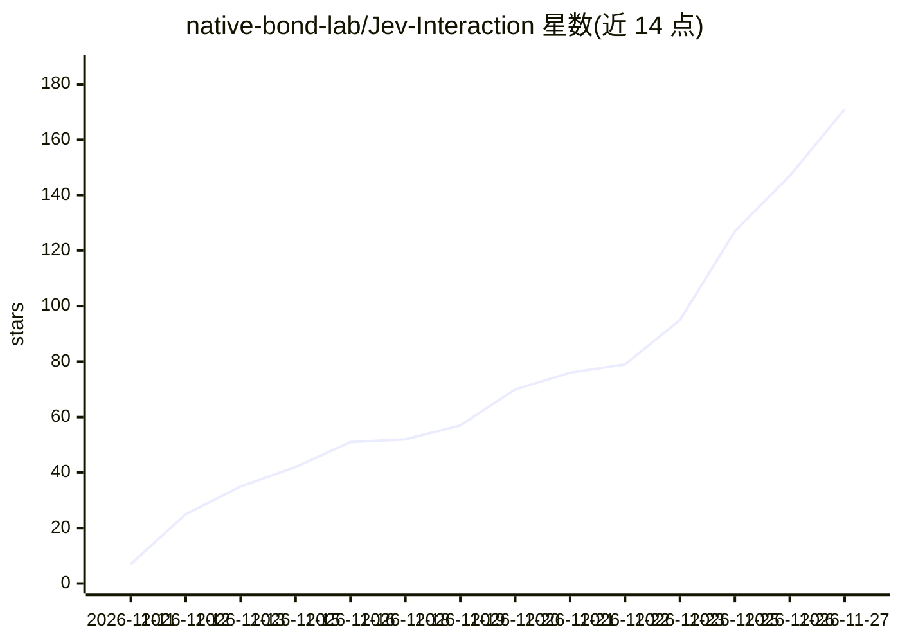

# native-bond-lab/Jev-Interaction

⭐ 171 · Python · Apache-2.0 · 推送 2026-11-23 · [GitHub](https://github.com/native-bond-lab/Jev-Interaction) · [官网](https://pupunpu-jev-interaction.hf.space/) · 组织维护 · 中文 README

**全双工语音交互引擎：用可读的自然语言规则控制轮次决策**

级联式全双工语音交互引擎：语音识别信号送入 Jev 小模型，以毫秒级回答 plain-language 多选题判定轮次（等待/接话/插话/回应音），再交由任意语言模型生成话语、任意语音合成发声。轮次问题、策略与人设均为可读可改可回放的文本，不训练任何模型，决策全程记录日志与概率。提供 Web 服务界面、Python SDK 与 Claude Code/Codex 等编码代理插件形态。

## 筛选速览

| 维度 | 判定 | 备注 |
|---|---|---|
| AI 角色 | `ai-native` | 本体是模型或模型工具 |
| 许可风险 | `permissive` | Apache-2.0 |
| 部署形态 | `self-host` | docker 或自建部署 |
| 模型依赖 | — | README 未给出锁定关系 |
| 硬件要求 | — | 无带数字的原话,不猜 |
| 安装摩擦 | `low` | 无编译、无系统依赖或容器化 |
| 成熟度 | — | 结构信号不足 |

## 能力要点

- 轮次决策以自然语言选择题呈现，可读、可改、可对录音回放
- 四个时刻（用户说话/安静/双方同时/代理说话）各配互斥动作集
- 语音识别、语言模型、语音合成各环节均可替换为自选提供方
- 零样本任务配置：任务画像为一页文本，无需训练

## 适用场景

- 搭建可打断、会回应音的全双工语音客服或陪伴代理
- 为电话语音产品定制轮次风格（耐心倾听/快速接话）
- 在编码代理会话中以语音下达后台任务并查询进度

## 场景标签

`语音 Agent` · 领域:对话与助手

## 证据(README 行号)

> L24: **Full duplex from a cascade.** Speech recognition → Jev's decisions → any language model → any speech synthesis. T
> L113: Jev-Interaction is an interaction engine, not a voice-activity detector. Jev never hears audio and never decides t
> L146: - **A new task is a few knobs, zero-shot.** Nothing here is trained on any benchmark or on your data. A task profi

## 星数曲线

2026-11-11 7 → 2026-11-27 171（+164）

---
*卡片 v1 · prompt 1.4 · 生成 2026-11-27 · 置信度 high · 依据 README sha `3728eda12f76` · [字段定义](../../DATASET.md)*
