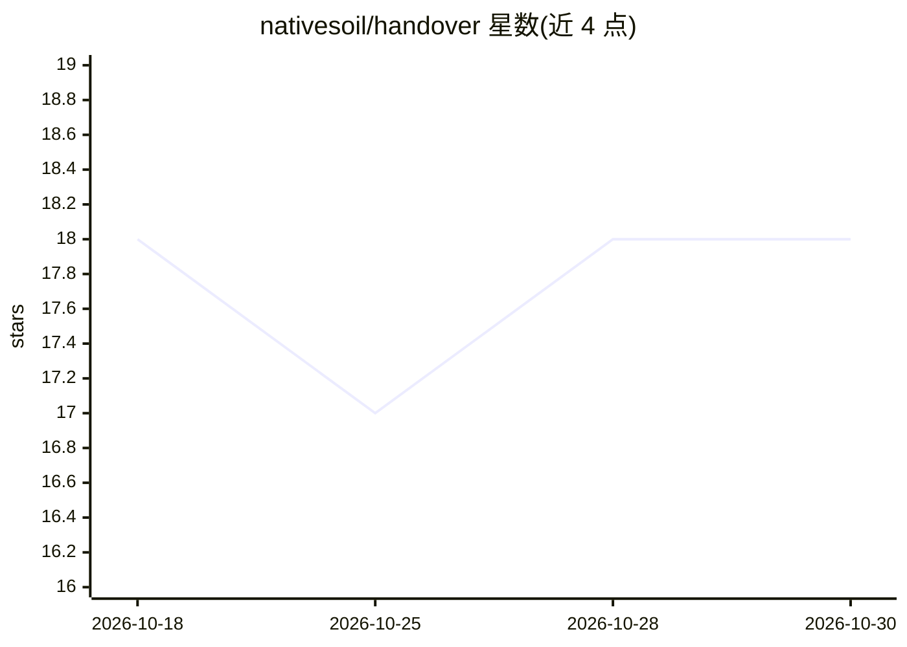

# nativesoil/handover

⭐ 18 · TypeScript · Apache-2.0 · 推送 2026-10-16 · [GitHub](https://github.com/nativesoil/handover) · [官网](https://nativesoil.dev) · 组织维护

**跨工具/模型迁移 AI 项目工作状态的开放 JSON 格式与本地工具链**

定义 handover.json 开放格式（17 个命名 section）并提供 soil CLI、本地 MCP server（soil_save/soil_load/soil_list）、自托管 server 预览与五个 SDK。捕获时按提取 recipe 让模型产出决策、约束、被否方案与当前任务，保存前经 JSON Schema 校验并扫描凭据形态值与私有路径，加载时渲染为可粘贴的恢复提示词。本地默认、无需账户与遥测；CLI/SDK 处于 0.2.0 公开预览，尚未发布到包注册表，需从源码 pnpm 构建。规范 1.0 对 1.x 线冻结。

## 筛选速览

| 维度 | 判定 | 备注 |
|---|---|---|
| AI 角色 | `ai-ecosystem` | LLM/agent 周边工具 |
| 许可风险 | `permissive` | Apache-2.0 |
| 部署形态 | `library` | 以包/库形式分发 |
| 模型依赖 | — | README 未给出锁定关系 |
| 硬件要求 | — | 无带数字的原话,不猜 |
| 安装摩擦 | `medium` | 含编译或系统依赖之一 |
| 成熟度 | `idea` | |

## 能力要点

- 17 section 的 handover.json 格式，规范 1.0 冻结
- 保存时 schema 校验 + 凭据/私有路径扫描，未过门不存储
- 本地 CLI + MCP server + 自托管 server + 五个 SDK，同一 conformance 契约
- 恢复时生成可粘贴 restore prompt，跨工具/模型继续会话

## 适用场景

- 换 AI 编码工具或模型时把项目工作状态带走
- 团队通过自托管 server 共享交接文档
- 通过 MCP 让客户端自行保存/加载交接状态

## 场景标签

`Agent 记忆` · 领域:Agent 开发

## 证据(README 行号)

> L27: Soil Handover is an open JSON format and local toolchain for carrying the
> L184: |Your AI client to save and load itself|The local MCP server: `soil_save`, `soil_load`, `soil_list`|docs/quickstar
> L199: Eight surfaces ship in this repository and run on your own machine: the local

## 星数曲线

2026-10-18 18 → 2026-10-30 18（+0）

---
*卡片 v1 · prompt 1.4 · 生成 2026-10-29 · 置信度 mid · 依据 README sha `590f936c3507` · [字段定义](../../DATASET.md)*
