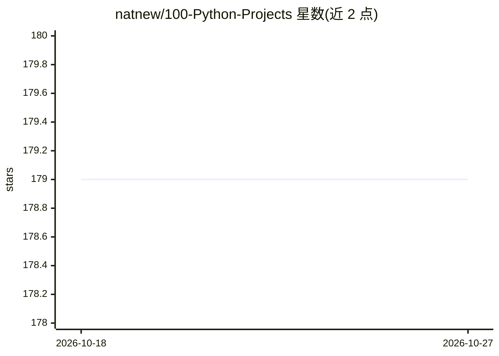

# natnew/100-Python-Projects

⭐ 179 · Python · MIT · 推送 2026-01-18 · [GitHub](https://github.com/natnew/100-Python-Projects) · [官网](https://natnew.github.io/100-Python-Projects/) · 个人维护

**100 个自包含 Python 项目的 AI Agent 工程教程仓库**

面向学习 AI 工程与 Agentic 工作流的教程型仓库，包含 100 个已完成的自包含 Python 项目，每个项目独立目录并带 src/main.py 与 README。内容分三层：Agent 基础（提示工程、工具使用、记忆与状态）、多 Agent 架构（消息总线、Master-Worker、群体模拟）、以及评测安全与治理（单元测试、红队测试、宪法 AI、GDPR 合规、人机协同），最终以集成各模式的 Omnibus Agent 收尾。技术栈以 Python 3.10+ 标准库为主，辅以 rich、matplotlib、mermaid。

## 筛选速览

| 维度 | 判定 | 备注 |
|---|---|---|
| AI 角色 | `ai-knowledge` | 知识聚合/清单类 |
| 许可风险 | `permissive` | MIT |
| 部署形态 | `None` |  |
| 模型依赖 | — | README 未给出锁定关系 |
| 硬件要求 | — | 无带数字的原话,不猜 |
| 安装摩擦 | `low` | 无编译、无系统依赖或容器化 |
| 成熟度 | — | 结构信号不足 |

## 能力要点

- 100 个自包含项目，覆盖提示工程到多 Agent 模拟再到安全治理
- 每个项目独立目录，含 src/main.py 与 README
- 涉及红队测试、宪法 AI、偏差检测、幻觉预防与 GDPR 合规等主题
- 基于 Python 3.10+ 标准库（threading/queue/sqlite3 等）实现

## 适用场景

- 系统学习从 LLM 交互到多 Agent 架构的工程实践
- 查阅 Agent 安全评测与治理框架的参考实现
- 作为数据科学/AI 作品集项目来源

## 场景标签

`教程课程` `多智能体` · 领域:Agent 开发

## 证据(README 行号)

> L7: This repository contains **100 self-contained Python projects** designed to master the field of AI Engineering and A
> L54: Each project is self-contained in its own directory with a `src/main.py` and `README.md`.

## 星数曲线

2026-10-18 179 → 2026-10-27 179（+0）

---
*卡片 v1 · prompt 1.4 · 生成 2026-10-22 · 置信度 high · 依据 README sha `2ae940397335` · [字段定义](../../DATASET.md)*
