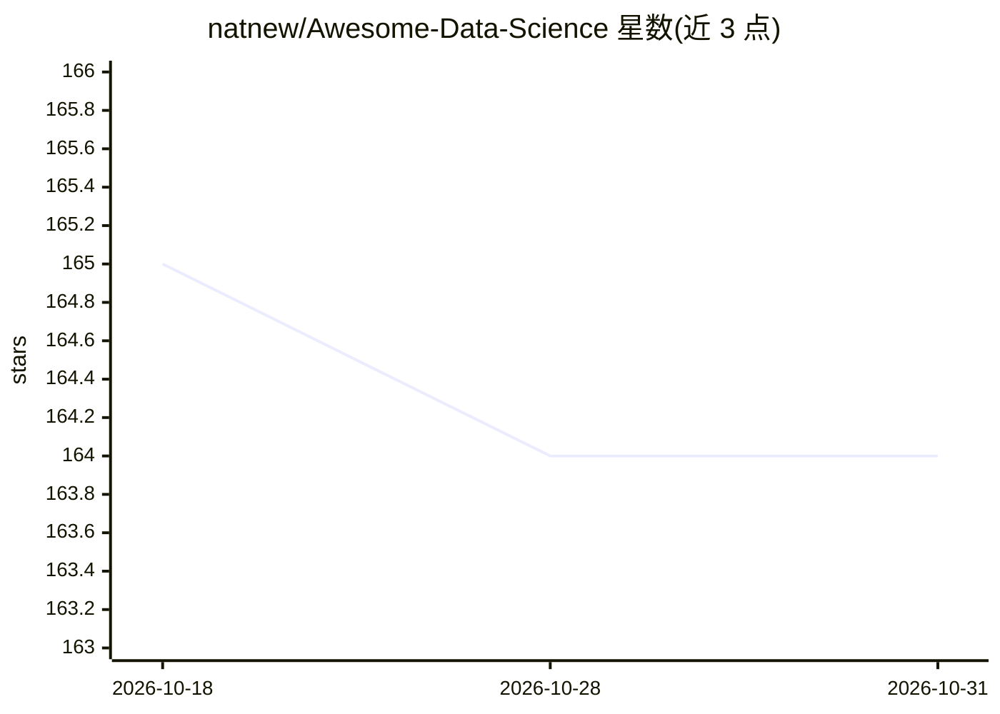

# natnew/Awesome-Data-Science

⭐ 164 · Jupyter Notebook · MIT · 推送 2026-02-18 · [GitHub](https://github.com/natnew/Awesome-Data-Science) · [官网](https://github.com/natnew.io/Awesome-Data-Science/) · 个人维护

**数据科学资源策展清单：文章、书籍、课程、数据集等分类汇总**

由 natnew 维护的数据科学资源聚合清单，定位为面向数据科学学习者的策展目录，并已升级为结构化学习平台（natnew.github.io 站点）。内容按 19 个类别组织，覆盖文章、书籍、速查表、社区、数据集、开发工具、在线课程、开源项目、播客、演讲、教程、视频，以及生成式 AI 与 LLM 专区和归档等。以 MIT 许可发布，接受社区贡献。

## 筛选速览

| 维度 | 判定 | 备注 |
|---|---|---|
| AI 角色 | `ai-knowledge` | 知识聚合/清单类 |
| 许可风险 | `permissive` | MIT |
| 部署形态 | `None` |  |
| 模型依赖 | — | README 未给出锁定关系 |
| 硬件要求 | — | 无带数字的原话,不猜 |
| 安装摩擦 | `low` | 无编译、无系统依赖或容器化 |
| 成熟度 | — | 结构信号不足 |

## 能力要点

- 19 个类别组织资源条目，含生成式 AI 与 LLM 专区
- 已升级为结构化学习平台站点
- MIT 许可，开放社区贡献

## 适用场景

- 查找数据科学书籍、课程与教程等学习资源
- 发现数据集与开发工具
- 跟踪生成式 AI 与 LLM 相关资源

## 场景标签

`精选清单` · 领域:学习与行业

## 证据(README 行号)

> L5: > **Note:** This repository has been upgraded to a structured learning platform. View the full site at natnew.github
> L8: Welcome to **Awesome Data Science**! This repository is a curated collection of valuable resources, tools, and tutor

## 星数曲线

2026-10-18 165 → 2026-10-31 164（-1）

---
*卡片 v1 · prompt 1.4 · 生成 2026-10-22 · 置信度 high · 依据 README sha `3283bca340a9` · [字段定义](../../DATASET.md)*
