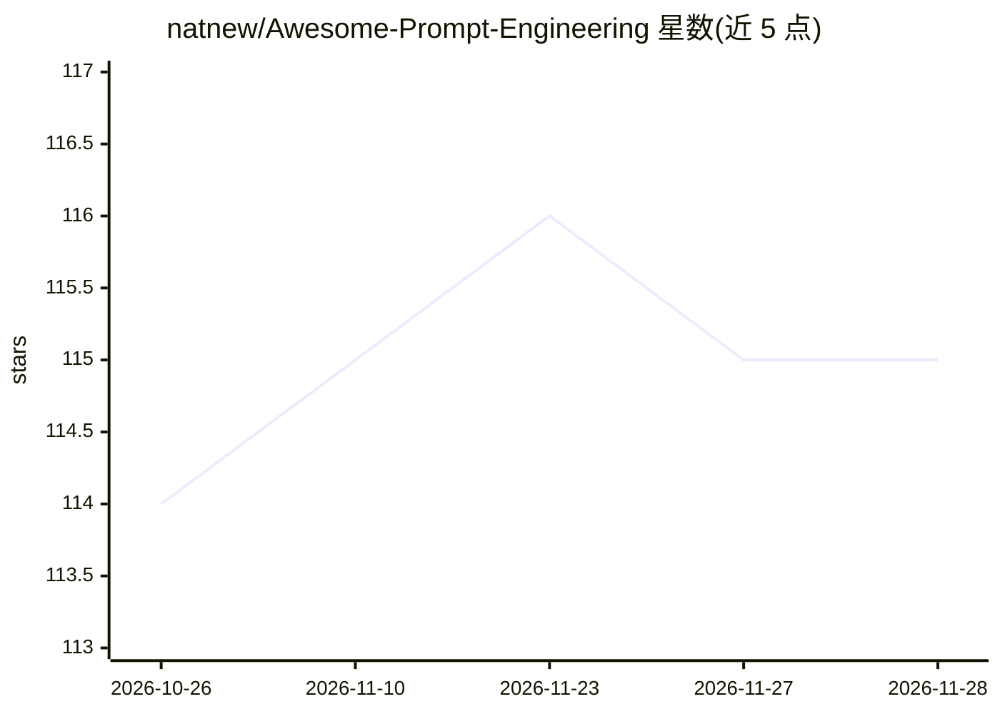

# natnew/Awesome-Prompt-Engineering

⭐ 115 · Python · MIT · 推送 2026-11-22 · [GitHub](https://github.com/natnew/Awesome-Prompt-Engineering) · [官网](https://natnew.github.io/Awesome-Prompt-Engineering/) · 个人维护

**提示词工程资源清单：从入门技巧到上下文工程**

一个 awesome 类资源聚合仓库，收录提示词工程（prompt engineering）与上下文工程相关资料，内容包括核心概念（系统提示、Few-Shot、Chain-of-Thought、RAG、工具定义、记忆管理）、工具与框架列表（提示管理、测试评估、安全护栏、Agent 技能）、指南与电子书链接。面向开发者、研究人员与 AI 从业者，按类别组织链接，仓库以 MIT 许可发布，并维护公告时间线与贡献者机制。

## 筛选速览

| 维度 | 判定 | 备注 |
|---|---|---|
| AI 角色 | `ai-knowledge` | 知识聚合/清单类 |
| 许可风险 | `permissive` | MIT |
| 部署形态 | `None` |  |
| 模型依赖 | — | README 未给出锁定关系 |
| 硬件要求 | — | 无带数字的原话,不猜 |
| 安装摩擦 | `low` | 无编译、无系统依赖或容器化 |
| 成熟度 | — | 结构信号不足 |

## 能力要点

- 覆盖提示词管理、开发框架、测试评估、安全护栏等类别的工具清单
- 核心概念部分列出系统提示、Few-Shot、CoT、RAG、工具定义与记忆管理
- 提供电子书、指南、速查表与 AI Agents 等学习资源链接
- 维护公告时间线与 all-contributors 贡献机制

## 适用场景

- 学习提示词工程的基础技巧与进阶上下文工程方法
- 查找提示词测试、评估与日志管理类工具
- 为编码类 agent 查找技能与子代理设计资源

## 场景标签

`提示工程` `精选清单` · 领域:Agent 开发

## 证据(README 行号)

> L6: **Prompt engineering** is the foundational practice of crafting effective instructions to guide AI models toward acc
> L12: ## Contents

## 星数曲线

2026-10-26 114 → 2026-11-28 115（+1）

---
*卡片 v1 · prompt 1.4 · 生成 2026-11-28 · 置信度 high · 依据 README sha `e8221254a833` · [字段定义](../../DATASET.md)*
