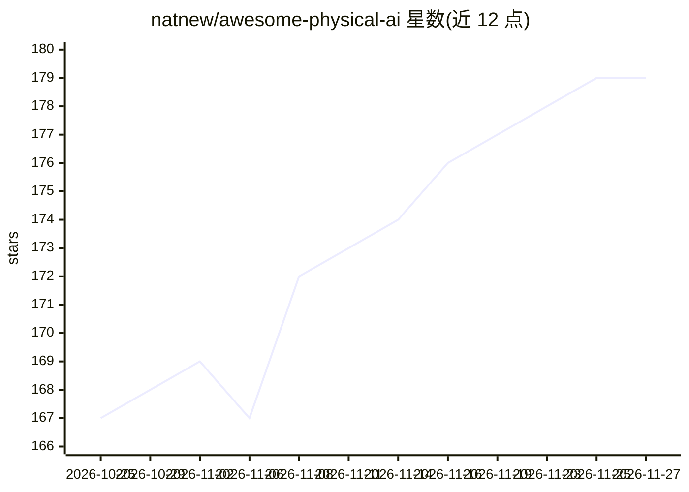

# natnew/awesome-physical-ai

⭐ 179 · MDX · MIT · 推送 2026-11-21 · [GitHub](https://github.com/natnew/awesome-physical-ai) · [官网](https://natnew.github.io/awesome-physical-ai/) · 个人维护

**Physical AI / 具身智能学习资源策展清单（258 条，14 类）**

面向机器人学与机器学习交叉领域的资源清单，收录 258 个条目并按 14 个规范类别组织，覆盖模拟器、数据集、基准、评估方法、机器人基础模型与 VLA 模型等。为研究者与从业者优先提供学习路径：从 Gymnasium 强化学习入门、MuJoCo 模拟、LeRobot 工作流到 OpenVLA 前沿模型，并按基础、机器人学习、基础模型、评估与安全、硬件五条路线分流。另有 GitHub Pages 在线文档站点，接受 PR 贡献。

## 筛选速览

| 维度 | 判定 | 备注 |
|---|---|---|
| AI 角色 | `ai-knowledge` | 知识聚合/清单类 |
| 许可风险 | `permissive` | MIT |
| 部署形态 | `None` |  |
| 模型依赖 | — | README 未给出锁定关系 |
| 硬件要求 | — | 无带数字的原话,不猜 |
| 安装摩擦 | `low` | 无编译、无系统依赖或容器化 |
| 成熟度 | — | 结构信号不足 |

## 能力要点

- 258 个条目按 14 个规范类别组织，含模拟器/数据集/基准/评估/基础模型
- 提供零基础快速入门路径（Gymnasium→MuJoCo→LeRobot→OpenVLA）
- 附 GitHub Pages 在线文档站点并接受社区 PR
- 条目附简短事实性说明，如数据规模与出处

## 适用场景

- 入门 Physical AI 时按路径系统学习模拟与机器人学习
- 查找机器人策略训练可用的大规模数据集与基准
- 调研 VLA 模型与通用机器人策略的开源实现
- 技术选型时浏览模拟器与评估工具选项

## 场景标签

`精选清单` · 领域:学习与行业

## 证据(README 行号)

> L10: Physical AI and embodied AI bring large-scale machine learning to robotics — agents that perceive, reason, and act 
> L20:  Last updated: 2026-11-12 &middot; 258 entries across 14 canonical categories
> L59: ## Contents

## 星数曲线

2026-10-25 167 → 2026-11-27 179（+12）

---
*卡片 v1 · prompt 1.4 · 生成 2026-11-26 · 置信度 high · 依据 README sha `34c01cc04e8b` · [字段定义](../../DATASET.md)*
