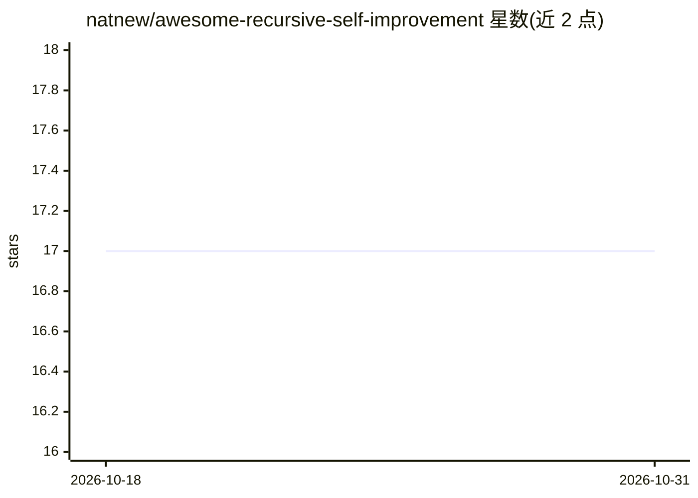

# natnew/awesome-recursive-self-improvement

⭐ 17 · JavaScript · MIT · 推送 2026-10-29 · [GitHub](https://github.com/natnew/awesome-recursive-self-improvement) · 个人维护

**AI 递归自我改进主题的资源策展清单**

收录 2022 年以来关于递归自我改进（recursive self-improvement）的论文与资源：涵盖自我精炼与反思、测试时适应、经验学习与记忆、自生成数据与自我奖励模型、基础文献等分类。条目按改进落点组织（推理时/数据与权重级/过程级），每条一句中性描述，链接经 CI 校验。另提供三条阅读路径（入门/构建系统/安全与限制）与一张 Mermaid 流程图说明各部分如何构成一个改进循环。

## 筛选速览

| 维度 | 判定 | 备注 |
|---|---|---|
| AI 角色 | `ai-knowledge` | 知识聚合/清单类 |
| 许可风险 | `permissive` | MIT |
| 部署形态 | `None` |  |
| 模型依赖 | — | README 未给出锁定关系 |
| 硬件要求 | — | 无带数字的原话,不猜 |
| 安装摩擦 | `low` | 无编译、无系统依赖或容器化 |
| 成熟度 | — | 结构信号不足 |

## 能力要点

- 按改进落点（推理时/数据权重级/过程级）组织条目
- 三条从入门到进阶的阅读路径
- 每条目一句中性描述，链接经 CI 校验
- 含受限的 2022 年前 Foundations 板块（已关闭新增）

## 适用场景

- 系统了解递归自我改进领域的研究脉络
- 按阅读路径快速入门或深入构建自我改进系统
- 查找自我精炼、测试时训练、经验记忆等方向的论文

## 场景标签

`精选清单` · 领域:学习与行业

## 证据(README 行号)

> L8: > A curated list of resources on recursive self-improvement in AI: systems that improve their own performance loops 
> L63: - Self-Improvement of Large Language Models: A Technical Overview and Future Outlook (arXiv 2026) - Organises LLM s

## 星数曲线

2026-10-18 17 → 2026-10-31 17（+0）

---
*卡片 v1 · prompt 1.4 · 生成 2026-10-30 · 置信度 high · 依据 README sha `b8fd70cc93c7` · [字段定义](../../DATASET.md)*
