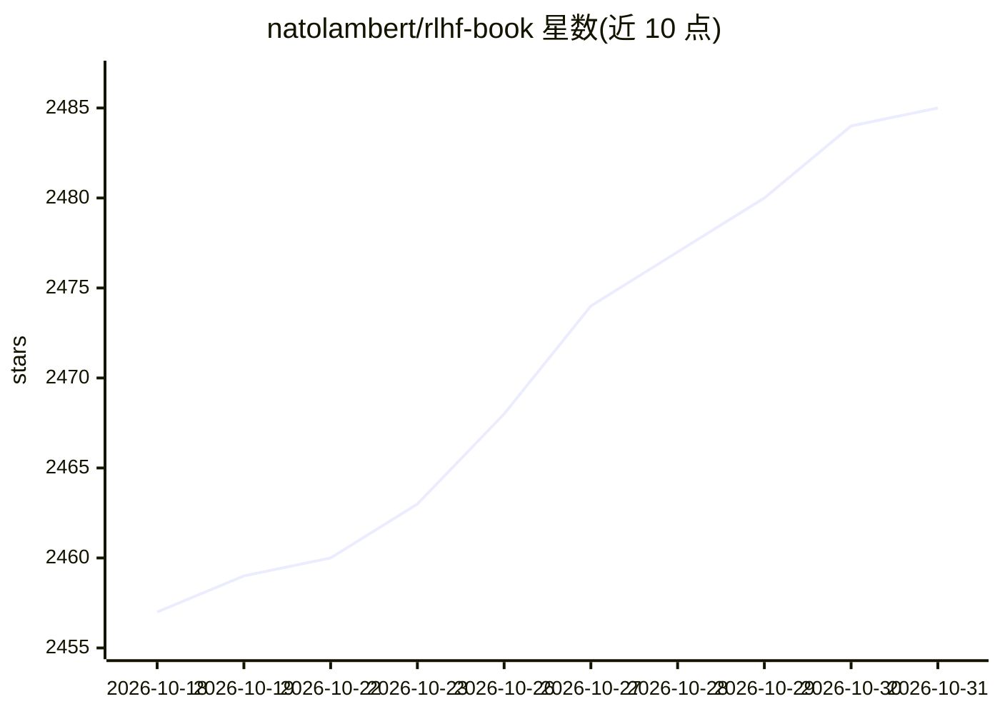

# natolambert/rlhf-book

⭐ 2,485 · Python · NOASSERTION · 推送 2026-10-26 · [GitHub](https://github.com/natolambert/rlhf-book) · [官网](https://rlhfbook.com/) · 个人维护 · 中文 README

**开源 RLHF 教科书：系统讲解 LLM 后训练与人类反馈对齐**

Nathan Lambert 编写的 Reinforcement Learning from Human Feedback 开源书籍，覆盖后训练语言模型的基础知识与广泛介绍。仓库含书籍 Markdown 源码（可用 make 构建 HTML/PDF）、RLHF 算法参考实现代码库（SFT、PPO/GRPO/RLOO、奖励模型、DPO、拒绝采样、SDPO 等）与可复用图表源文件。有 arXiv 版与 Manning 纸质版，社区维护非官方中文翻译。章节以 CC-BY-NC-SA-4.0 许可，另附 AI 使用政策说明写作流程。

## 筛选速览

| 维度 | 判定 | 备注 |
|---|---|---|
| AI 角色 | `ai-knowledge` | 知识聚合/清单类 |
| 许可风险 | `none` | NOASSERTION |
| 部署形态 | `None` |  |
| 模型依赖 | — | README 未给出锁定关系 |
| 硬件要求 | — | 无带数字的原话,不猜 |
| 安装摩擦 | `low` | 无编译、无系统依赖或容器化 |
| 成熟度 | — | 结构信号不足 |

## 能力要点

- 覆盖 SFT、策略梯度（PPO/REINFORCE/GRPO/RLOO）、奖励模型、DPO、拒绝采样等参考实现
- 书籍源码可用 make 构建 HTML 与 PDF（PDF 需 LaTeX）
- diagrams 目录提供可复用于演示与博客的图表源文件
- 存在 arXiv 版本与 Manning 纸质版，社区维护中文翻译

## 适用场景

- 系统学习 RLHF 与 LLM 后训练方法
- 获取主流对齐算法的参考实现代码
- 复用书中图表用于演讲或学习材料

## 场景标签

`强化学习` `教程课程` · 领域:学习与行业

## 证据(README 行号)

> L3: A comprehensive guide to Reinforcement Learning from Human Feedback (and a broad introduction to post-training langu
> L36: Reference implementations for RLHF algorithms in `code/`:

## 星数曲线

2026-10-18 2,457 → 2026-10-31 2,485（+28）

---
*卡片 v1 · prompt 1.4 · 生成 2026-10-21 · 置信度 high · 依据 README sha `f9f8d4ce557f` · [字段定义](../../DATASET.md)*
