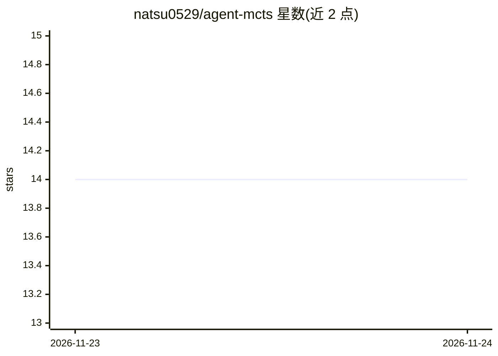

# natsu0529/agent-mcts

⭐ 15 · Python · MIT · 推送 2026-11-23 · [GitHub](https://github.com/natsu0529/agent-mcts) · [官网](https://pypi.org/project/agent-mcts/) · 个人维护

**给编码 agent 加 MCTS 树搜索的测试时搜索框架**

以 MIT 许可开源的测试时搜索框架，在编码 agent CLI 外层包一层蒙特卡洛树搜索：agent 不再单轨迹运行，而是多分支探索、回溯死路并集中预算。每个节点是隔离的 git worktree 加派生会话，价值函数以用户测试命令的通过率打分，支持 --generate-tests 与 --judge 模式；搜索结果以 squash merge 应用，运行日志追加写入 jsonl。当前 Claude Code 适配已验证，Codex CLI 适配仅对假二进制测试过，Kimi CLI 计划中。以 uv 安装，纯 Python，终端内展示实时树。

## 筛选速览

| 维度 | 判定 | 备注 |
|---|---|---|
| AI 角色 | `ai-ecosystem` | LLM/agent 周边工具 |
| 许可风险 | `permissive` | MIT |
| 部署形态 | `None` |  |
| 模型依赖 | — | README 未给出锁定关系 |
| 硬件要求 | — | 无带数字的原话,不猜 |
| 安装摩擦 | `low` | 无编译、无系统依赖或容器化 |
| 成熟度 | `idea` | |

## 能力要点

- 真实 MCTS（UCT 选择/扩展/评估/回溯），预算向有希望分支倾斜
- 节点为隔离 git worktree+派生会话，应用前不动工作区
- 价值函数基于测试通过率，支持生成测试与 LLM judge 两种模式
- 终端实时树展示，随时中断可 resume 续搜

## 适用场景

- 让编码 agent 在有规格的任务上多分支求解并回溯
- 为测试时搜索研究提供真实软件任务的研究框架
- 对失败修复给出多次尝试并以隐藏测试评分择优

## 场景标签

`编码 Agent` · 领域:编码与开发

## 证据(README 行号)

> L5: `agent-mcts` is an open-source (MIT) test-time search harness that wraps a coding agent CLI with Monte Carlo Tree Se
> L40: - **Bring your own agent.** A thin adapter layer speaks to each agent's headless mode (`claude -p`; `codex exec` un

## 星数曲线

2026-11-23 14 → 2026-11-24 14（+0）

---
*卡片 v1 · prompt 1.4 · 生成 2026-11-23 · 置信度 high · 依据 README sha `066b109f58df` · [字段定义](../../DATASET.md)*
