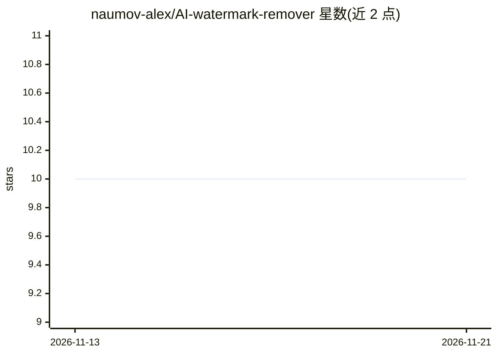

# naumov-alex/AI-watermark-remover

⭐ 10 · Python · 推送 2026-08-15 · [GitHub](https://github.com/naumov-alex/AI-watermark-remover) · 个人维护

**去除 AI 生成文本水印的多阶段流水线应用**

面向需要对 AI 生成文本做后处理的用户，提供四步流水线：符号清理（破折号、零宽字符、花引号等排版标记）、翻译往返（Google/Mymemory/Deepl 可选）、LLM 改写（可多次候选取检测分最低者）、以及可选的 SynthID 检测器逐阶段评分。各步骤均可独立开关，配置写入 gitignored 的 config.yaml，API key 存于 .env。README 附带实验数据并明确说明单样本结果的局限。

## 筛选速览

| 维度 | 判定 | 备注 |
|---|---|---|
| AI 角色 | `ai-native` | 本体是模型或模型工具 |
| 许可风险 | `none` | — |
| 部署形态 | `None` |  |
| 模型依赖 | local-ok | 支持本地模型 |
| 硬件要求 | `cpu-ok` | |
| 安装摩擦 | `medium` | 含编译或系统依赖之一 |
| 成熟度 | — | 结构信号不足 |

## 能力要点

- clean → translate → paraphrase → clean 四步流水线，每步可独立开关
- 多次改写候选项按 SynthID 分数/z-score 排序择优
- 逐阶段评分验证表展示水印在每一步的变化
- 本地 Ollama 路径无需 API key

## 适用场景

- 对 AI 生成文本做排版符号清理
- 用翻译往返与 LLM 改写处理文本后查看 SynthID 检测分数变化
- 本地无需 API key 地运行改写流程

## 场景标签

`AI 写作` · 领域:内容生成

## 证据(README 行号)

> L3: An application that uses a multistep pipeline to remove any watermarks from AI generated text
> L12: Paraphrasing runs through OpenRouter, OpenAI, Gemini, Claude or a local Ollama model.
> L169: |`src/pipeline.py`|Orchestrates clean -> translate -> paraphrase -> clean|

## 星数曲线

2026-11-13 10 → 2026-11-21 10（+0）

---
*卡片 v1 · prompt 1.4 · 生成 2026-11-19 · 置信度 high · 依据 README sha `4a1f0494c4bc` · [字段定义](../../DATASET.md)*
