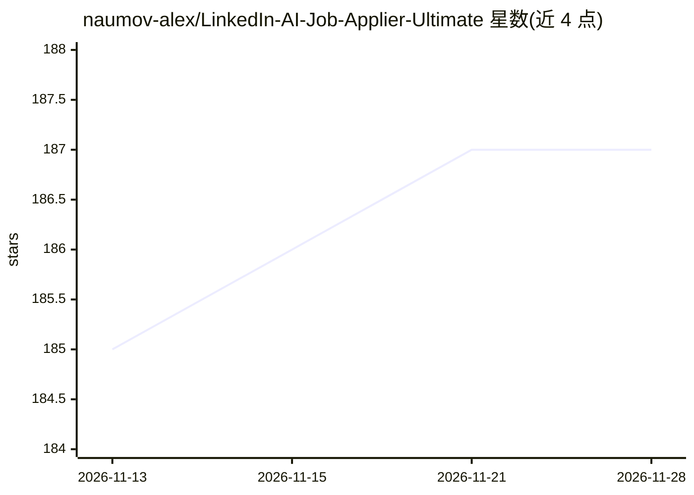

# naumov-alex/LinkedIn-AI-Job-Applier-Ultimate

⭐ 187 · Python · MIT · 推送 2026-10-23 · [GitHub](https://github.com/naumov-alex/LinkedIn-AI-Job-Applier-Ultimate) · 个人维护

**用 AI 自动投递 LinkedIn/Indeed 职位并生成定制简历的机器人**

基于 Python 的求职自动化机器人：用 Patchright（Playwright 补丁版）驱动浏览器在 LinkedIn 与 Indeed 上自动投递职位；用 LLM（Gemini/OpenAI/Claude/Ollama）解析简历、按职位描述生成定制简历、回答申请表问题，并支持 LLM 筛选最匹配职位。发往 LLM 前对个人数据做匿名化替换。附带技能需求统计、Telegram 报告、本地监控面板、自动人脉拓展与每 24 小时定时运行。为原 AIHawk 项目的活跃 fork；README 声明目标网站 UI 变化可能导致功能随时失效，Indeed 支持存在 Easy Apply 占比低与 CAPTCHA 频繁等限制，推荐以 LinkedIn 为主。

## 筛选速览

| 维度 | 判定 | 备注 |
|---|---|---|
| AI 角色 | `ai-native` | 本体是模型或模型工具 |
| 许可风险 | `permissive` | MIT |
| 部署形态 | `self-host` | docker 或自建部署 |
| 模型依赖 | local-ok | 支持本地模型 |
| 硬件要求 | — | 无带数字的原话,不猜 |
| 安装摩擦 | `low` | 无编译、无系统依赖或容器化 |
| 成熟度 | — | 结构信号不足 |

## 能力要点

- 自动投递 LinkedIn（含非 Easy Apply）与 Indeed 职位
- LLM 按职位描述生成定制简历并回答申请问题，支持 Gemini/OpenAI/Claude/Ollama
- 个人数据发往 LLM 前做匿名化替换
- 本地监控面板、Telegram 报告与每 24 小时自动运行

## 适用场景

- 自动化批量投递 LinkedIn 职位并按岗位定制简历
- 统计目标职位市场需求最高的技能以调整简历
- 通过 Telegram 接收投递运行报告与错误通知

## 场景标签

`浏览器自动化` `AI 写作` · 领域:效率与自动化

## 证据(README 行号)

> L10: 🤖 AI-powered bot that **auto-applies** to jobs on **LinkedIn** and **Indeed**. It parses your resume, generates tai
> L55: * **🎯 Improved Intelligent Resume Generation:** Uses AI to tailor every generated resume to the current vacancy for

## 星数曲线

2026-11-13 185 → 2026-11-28 187（+2）

---
*卡片 v1 · prompt 1.4 · 生成 2026-11-17 · 置信度 high · 依据 README sha `24d35eb34947` · [字段定义](../../DATASET.md)*
