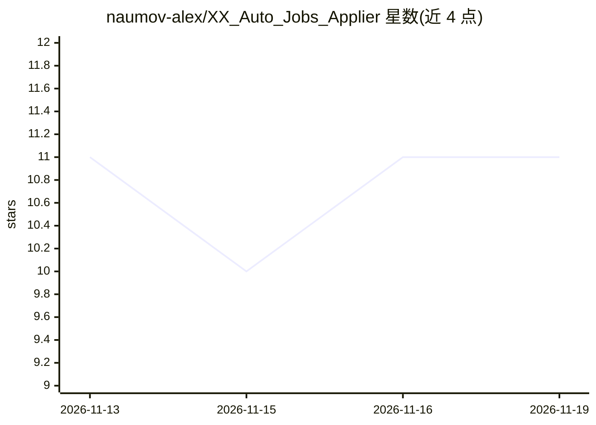

# naumov-alex/XX_Auto_Jobs_Applier

⭐ 11 · Python · NOASSERTION · 推送 2026-10-23 · [GitHub](https://github.com/naumov-alex/XX_Auto_Jobs_Applier) · 个人维护

**面向 hh.ru 求职者的 AI 自动投递助手**

一个 hh.ru 求职自动化工具，为求职者自动筛选并回应职位。工作流：按配置搜索职位并过滤黑名单公司，LLM 评估职位与简历匹配度并决定是否投递，自动填写雇主表单、回答问题、按职位要求生成个性化求职信与简历，并支持自动提升简历排名与验证码协助。通过 Playwright 浏览器模拟运行（官方 API 已停止对个人开放），提供日志记录、费用统计与 Telegram 通知机制。LLM 数据发送前匿名化处理。

## 筛选速览

| 维度 | 判定 | 备注 |
|---|---|---|
| AI 角色 | `ai-native` | 本体是模型或模型工具 |
| 许可风险 | `permissive` | NOASSERTION |
| 部署形态 | `None` |  |
| 模型依赖 | local-ok | 支持本地模型 |
| 硬件要求 | — | 无带数字的原话,不猜 |
| 安装摩擦 | `low` | 无编译、无系统依赖或容器化 |
| 成熟度 | `idea` | |

## 能力要点

- LLM 评估职位-简历匹配度（1-100 阈值）并自动决定投递
- 按职位要求自动生成求职信与简历，自动回答雇主问题
- Telegram 通知错误、验证码协助与投递结果汇总
- 发送 LLM 前对个人数据匿名化，本地 YAML 存储隐私数据

## 适用场景

- 在 hh.ru 上批量自动投递符合我简历的职位
- 让 AI 按每个职位的要求帮我写求职信和简历
- 不想盯屏幕时让 bot 挂后台自动回应职位问题

## 场景标签

`浏览器自动化` `AI 写作` · 领域:效率与自动化

## 证据(README 行号)

> L36: XX_Auto_Jobs_Applier — передовой автоматизированный инструмент, предназначенный для автоматизации поиска и подачи з
> L40: Вам больше не нужно тратить бесчисленное количество времени на вычитывание и прокликивание всех интересующих вас ва
> L58: 3. **AI персонализация**

## 星数曲线

2026-11-13 11 → 2026-11-19 11（+0）

---
*卡片 v1 · prompt 1.4 · 生成 2026-11-18 · 置信度 high · 依据 README sha `bb2b7d20d41c` · [字段定义](../../DATASET.md)*
