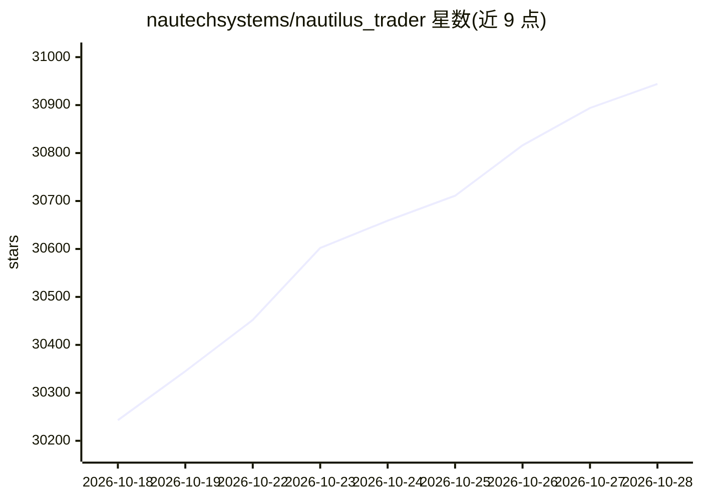

# nautechsystems/nautilus_trader

⭐ 31,000 · Rust · LGPL-3.0 · 推送 2026-10-28 · [GitHub](https://github.com/nautechsystems/nautilus_trader) · [官网](https://nautilustrader.io) · 组织维护

**面向量化交易者的 Rust 原生事件驱动多资产交易引擎**

开源生产级交易引擎：Rust 核心 + Python 控制平面（PyO3 绑定），统一研究、确定性回测与实盘执行，同一策略代码可跨回测与实盘运行。覆盖加密交易所（CEX/DEX）、外汇、股票、期货、期权与博彩交易所，通过 20 个模块化适配器接入 REST/WebSocket 场所。支持纳秒级回测、高级订单类型（OCO/OUO/OTO 等）、多场所做市策略，并声明引擎速度足以训练 AI 交易代理（RL/ES）。处于活跃开发期，版本间可能出现破坏性变更。

## 筛选速览

| 维度 | 判定 | 备注 |
|---|---|---|
| AI 角色 | `ai-enhanced` | 去掉 AI 部分产品仍成立 |
| 许可风险 | `viral` | LGPL-3.0 |
| 部署形态 | `desktop` | 安装包/桌面程序 |
| 模型依赖 | — | README 未给出锁定关系 |
| 硬件要求 | — | 无带数字的原话,不猜 |
| 安装摩擦 | `low` | 无编译、无系统依赖或容器化 |
| 成熟度 | `idea` | |

## 动量与使用信号

- 维护:`active` — 距上次 push 0.7 天,年发版 16,214 位贡献者
- 涨星:近 1 天 **+116**(自 20261016 起算)
- 安装:pypi 包 `nautilus_trader` 月下载 353,140
- 平台:WINDOWS / MACOS / LINUX · 协议:—

## 能力要点

- 同一策略与执行算法代码跨回测与实盘运行
- 20 个集成适配器覆盖加密、传统市场与预测/博彩交易所
- 纳秒级分辨率的多场所、多品种同时回测
- Rust 核心配 Python 控制平面，无需 Rust 工具链即可安装预编译 wheel

## 适用场景

- 在统一架构下完成策略研究、回测与实盘部署
- 跨多个交易所运行做市或跨场所套利策略
- 以引擎作为环境训练强化学习交易代理

## 场景标签

`金融量化` · 领域:学习与行业

## 证据(README 行号)

> L30: NautilusTrader is an open-source, production-grade, Rust-native engine for multi-asset,
> L63: - **AI Training**: Engine fast enough to train AI trading agents (RL/ES).

## 星数曲线

2026-10-18 30,243 → 2026-10-28 30,944（+701）

---
*卡片 v1 · prompt 1.4 · 生成 2026-10-20 · 置信度 high · 依据 README sha `4ea131cc9bf2` · [字段定义](../../DATASET.md)*
