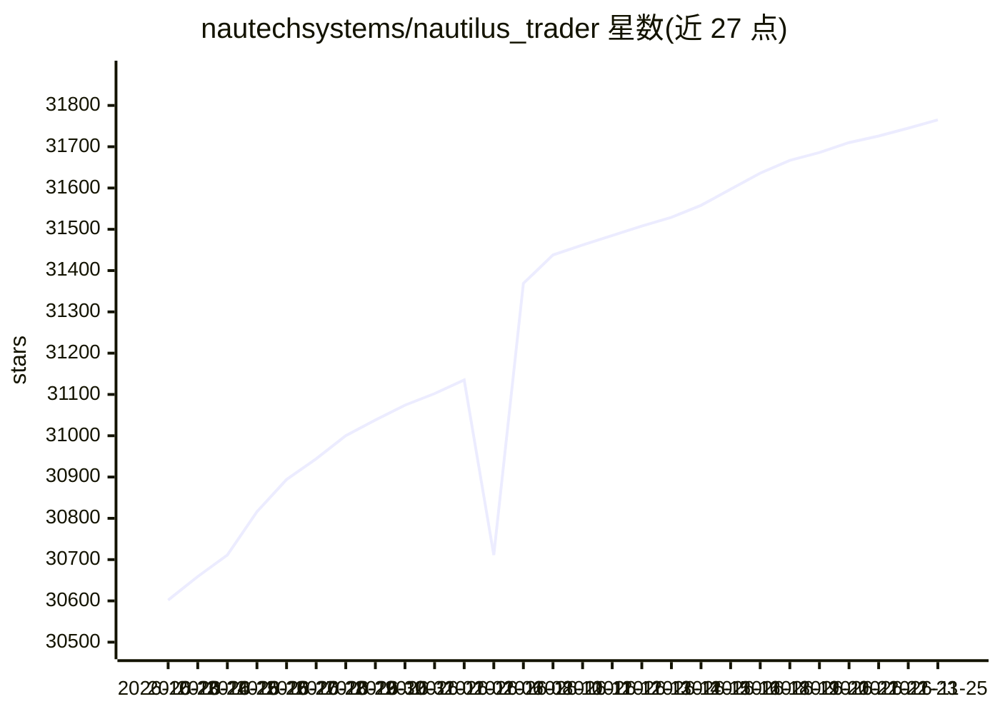

# nautechsystems/nautilus_trader

⭐ 31,765 · Rust · LGPL-3.0 · 推送 2026-11-23 · [GitHub](https://github.com/nautechsystems/nautilus_trader) · [官网](https://nautilustrader.io) · 组织维护

**面向交易者的 Rust 原生多资产事件驱动交易引擎**

Rust 原生的开源交易系统引擎，覆盖研究、确定性回测模拟与实盘执行，采用确定性事件驱动架构，Python 作为策略逻辑与编排的控制平面，也可全部用 Rust 编写。通过模块化适配器接入任意 REST API 或 WebSocket 数据源的交易所与数据商，覆盖加密货币 CEX/DEX、外汇、股票、期货、期权与博彩交易所等；同一套策略代码可在回测与实盘间复用。安装以 PyPI 预编译 wheel 为主，无需 Rust 工具链，另支持 Docker 部署；项目声明仍在活跃开发中，API 可能出现破坏性变更。

## 筛选速览

| 维度 | 判定 | 备注 |
|---|---|---|
| AI 角色 | `ai-enhanced` | 去掉 AI 部分产品仍成立 |
| 许可风险 | `viral` | LGPL-3.0 |
| 部署形态 | `desktop` | 安装包/桌面程序 |
| 模型依赖 | — | README 未给出锁定关系 |
| 硬件要求 | — | 无带数字的原话,不猜 |
| 安装摩擦 | `low` | 无编译、无系统依赖或容器化 |
| 成熟度 | `idea` | |

## 动量与使用信号

- 维护:`active` — 距上次 push 0.7 天,年发版 16,214 位贡献者
- 涨星:近 1 天 **+116**(自 20261016 起算)
- 安装:pypi 包 `nautilus_trader` 月下载 353,140
- 平台:WINDOWS / MACOS / LINUX · 协议:—

## 能力要点

- Rust 核心引擎，Python 通过 PyO3 绑定作为控制平面
- 回测与实盘使用同一策略与执行算法代码
- 适配器接入 Binance、Bybit、Interactive Brokers 等 20+ 交易所与数据商
- 纳秒级分辨率回测，支持多种订单类型与条件触发

## 适用场景

- 在历史 tick/订单簿数据上回测多市场多策略组合
- 将同一策略从研究环境迁移到实盘部署
- 训练 AI 交易代理（RL/ES）用于交易研究
- 跨多个交易所同时运行做市与跨市场策略

## 场景标签

`金融量化` · 领域:学习与行业

## 证据(README 行号)

> L30: NautilusTrader is an open-source, production-grade, Rust-native engine for multi-asset,
> L63: - **AI Training**: Engine fast enough to train AI trading agents (RL/ES).
> L85: Python bindings are provided via PyO3 for the Rust-native v2 runtime.

## 星数曲线

2026-10-23 30,602 → 2026-11-25 31,765（+1,163）

---
*卡片 v1 · prompt 1.4 · 生成 2026-11-22 · 置信度 high · 依据 README sha `6e8aec6f5771` · [字段定义](../../DATASET.md)*
