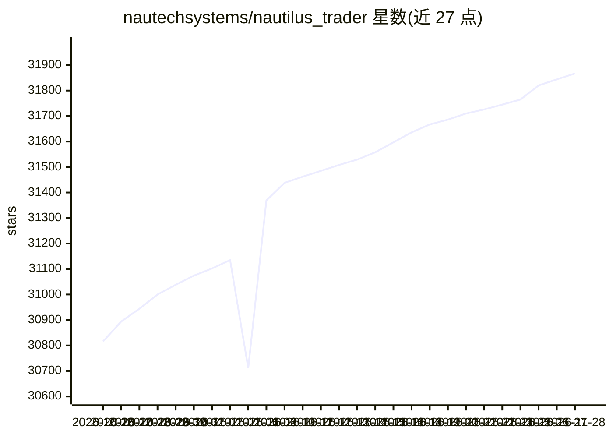

# nautechsystems/nautilus_trader

⭐ 31,867 · Rust · LGPL-3.0 · 推送 2026-11-27 · [GitHub](https://github.com/nautechsystems/nautilus_trader) · [官网](https://nautilustrader.io) · 组织维护

**面向量化交易者的 Rust 原生多资产回测与实盘交易引擎**

NautilusTrader 是开源的 Rust 原生交易引擎，覆盖研究、确定性模拟回测与实盘执行，采用事件驱动架构，Python 作为策略逻辑、配置与编排的控制平面，也可全部用 Rust 编写。通过模块化适配器接入任何 REST API 或 WebSocket 数据源的交易场所，现有集成覆盖 CEX/DEX 加密货币交易所、外汇/股票/期货/期权等传统市场及博彩交易所，列出 19 个适配器。同一策略与执行算法代码可在回测与实盘间复用。预编译 wheel 无需 Rust 工具链即可安装；当前处于 v2 过渡期，v1 仅接收关键安全补丁。

## 筛选速览

| 维度 | 判定 | 备注 |
|---|---|---|
| AI 角色 | `ai-enhanced` | 去掉 AI 部分产品仍成立 |
| 许可风险 | `viral` | LGPL-3.0 |
| 部署形态 | `desktop` | 安装包/桌面程序 |
| 模型依赖 | — | README 未给出锁定关系 |
| 硬件要求 | — | 无带数字的原话,不猜 |
| 安装摩擦 | `low` | 无编译、无系统依赖或容器化 |
| 成熟度 | — | 结构信号不足 |

## 动量与使用信号

- 维护:`active` — 距上次 push 0.7 天,年发版 16,214 位贡献者
- 涨星:近 1 天 **+116**(自 20261016 起算)
- 安装:pypi 包 `nautilus_trader` 月下载 353,140
- 平台:WINDOWS / MACOS / LINUX · 协议:—

## 能力要点

- Rust 核心 + Python 控制平面的单一代码库贯穿回测与实盘
- 19 个交易所/数据源适配器（Binance、Bybit、Interactive Brokers、Polymarket 等）
- 纳秒级分辨率的历史 tick/订单簿数据回测
- 支持训练 AI 交易代理（RL/ES）

## 适用场景

- 对加密货币、外汇、股票、期货、期权等策略进行回测与实盘部署
- 跨多个交易所同时运行做市与跨所策略
- 以确定性事件驱动架构训练强化学习交易代理

## 场景标签

`金融量化` `强化学习` · 领域:学习与行业

## 证据(README 行号)

> L30: NautilusTrader is an open-source, production-grade, Rust-native engine for multi-asset,
> L34: event-driven architecture, with Python serving as the control plane for strategy logic,
> L63: - **AI Training**: Engine fast enough to train AI trading agents (RL/ES).

## 星数曲线

2026-10-26 30,816 → 2026-11-28 31,867（+1,051）

---
*卡片 v1 · prompt 1.4 · 生成 2026-11-27 · 置信度 high · 依据 README sha `8555b06b6a47` · [字段定义](../../DATASET.md)*
