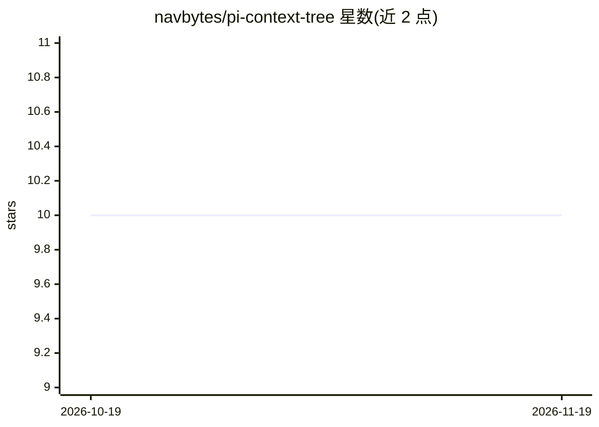

# navbytes/pi-context-tree

⭐ 10 · TypeScript · MIT · 推送 2026-11-03 · [GitHub](https://github.com/navbytes/pi-context-tree) · 个人维护

**为 pi 编码代理提供 git 式上下文分支/合并/裁剪与会话面板**

pi（编码代理）的扩展包，把会话树组织成 git 风格工作流：/branch 从当前节点分出支线（可切到更便宜的模型），/merge 以 squash 方式把支线折叠为经人工确认的决策记录，/crop 对臃肿的工具/MCP 结果做 append-only 的裁剪（可恢复），/undo 一键回滚最近变更，/panel 提供全屏 TUI 展示每节点 token 成本、上下文占用大头与决策卡。所有变更不修改原始会话 JSONL。要求 pi 0.84.3+ 与 Node.js ≥22.19，通过 pi install 安装 npm 包。

## 筛选速览

| 维度 | 判定 | 备注 |
|---|---|---|
| AI 角色 | `ai-ecosystem` | LLM/agent 周边工具 |
| 许可风险 | `permissive` | MIT |
| 部署形态 | `library` | 以包/库形式分发 |
| 模型依赖 | — | README 未给出锁定关系 |
| 硬件要求 | — | 无带数字的原话,不猜 |
| 安装摩擦 | `low` | 无编译、无系统依赖或容器化 |
| 成熟度 | — | 结构信号不足 |

## 能力要点

- /branch//merge//crop//undo 的 git 式会话上下文管理命令
- merge 产出人工确认的决策记录，保留支线原始历史
- 全屏 TUI 上下文面板：每节点 token 成本、占用排行、决策卡与一键操作
- append-only 设计：不修改会话 JSONL，所有变更可恢复

## 适用场景

- 在 pi 中探索支线任务后只把结论带回主会话
- 裁剪占满上下文窗口的臃肿工具结果以保持检索质量
- 把分支讨论导出为 markdown 决策记录用于 PR/ADR
- 查看会话中哪些条目占用最多 token 并就地处理

## 场景标签

`编码 Agent` `Agent 记忆` · 领域:Agent 开发

## 证据(README 行号)

> L24: **pi-context-tree** is a pi package that turns the session tree into a git-style workflow with a rich context panel
> L73: - **pi** (the coding agent) — built and tested against `@earendil-works/*@0.84.3` (newer pi usually works too; see 
> L76: `pi install` handles everything else; pi provides its core packages to the extension at runtime.

## 星数曲线

2026-10-19 10 → 2026-11-19 10（+0）

---
*卡片 v1 · prompt 1.4 · 生成 2026-11-19 · 置信度 high · 依据 README sha `b34f02718196` · [字段定义](../../DATASET.md)*
