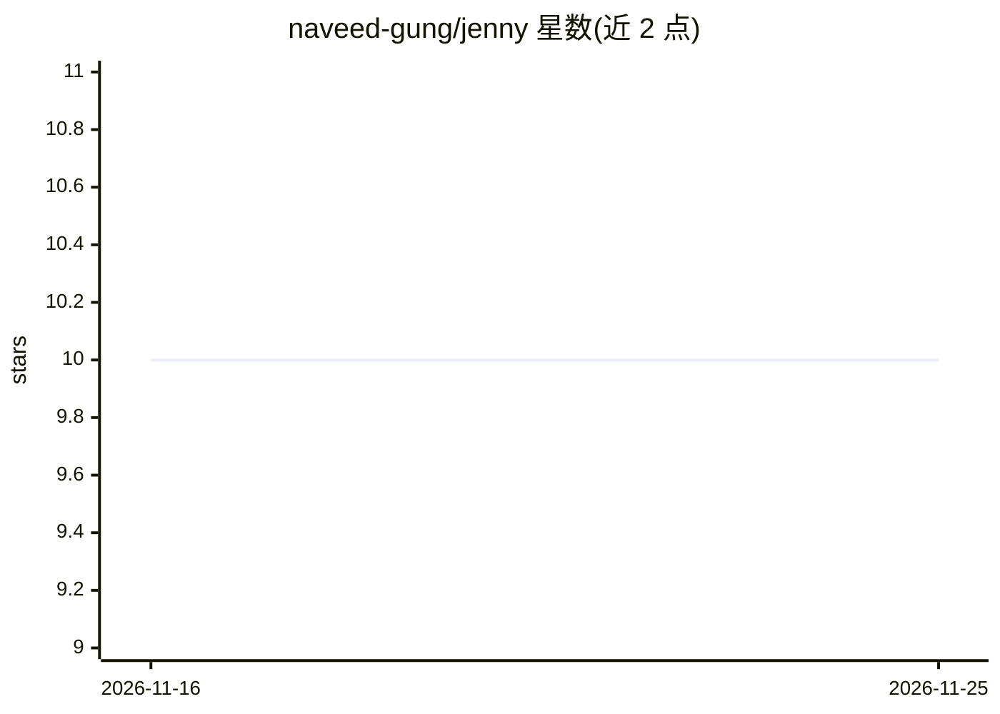

# naveed-gung/jenny

⭐ 10 · JavaScript · 推送 2026-07-19 · [GitHub](https://github.com/naveed-gung/jenny) · 个人维护

**实时 3D 数字人对话应用：聊天+语音+口型同步**

开源 3D AI 头像应用，前端用 React 与 React Three Fiber 渲染可表现情绪、口型同步的 GLB 头像，Node.js/Express 后端调用 Google Gemini 生成对话回复、TTS 服务生成语音、FFmpeg 处理音频、Rhubarb Lip Sync 生成口型数据。支持多语音配置、音调/语速调节、Render 部署。目前处于维护模式，功能开发暂停；默认头像的口型（viseme）集合有限，已记录表情与口型互相干扰的问题。

## 筛选速览

| 维度 | 判定 | 备注 |
|---|---|---|
| AI 角色 | `ai-native` | 本体是模型或模型工具 |
| 许可风险 | `none` | — |
| 部署形态 | `library` | 以包/库形式分发 |
| 模型依赖 | — | README 未给出锁定关系 |
| 硬件要求 | — | 无带数字的原话,不猜 |
| 安装摩擦 | `medium` | 含编译或系统依赖之一 |
| 成熟度 | — | 结构信号不足 |

## 能力要点

- Google Gemini 驱动的对话生成与上下文驱动的表情控制
- Rhubarb Lip Sync 生成口型时序并与语音同步播放
- 支持 ElevenLabs、SpeechGen 等 TTS 服务与多语音配置
- 提供 GLB/GLTF 头像替换规范与 Render Blueprint 部署配置

## 适用场景

- 搭建可对话的虚拟助手或数字人
- 制作有口型与表情的交互式教育角色
- 为 AI 客服场景提供 Web 3D 头像界面原型

## 场景标签

`聊天机器人` `语音合成` · 领域:对话与助手

## 证据(README 行号)

> L31: Jenny is an open-source 3D AI avatar application that combines conversational artificial intelligence, speech synth
> L50: - AI-powered conversations using Google Gemini
> L112: |Google Gemini|Conversational response generation|

## 星数曲线

2026-11-16 10 → 2026-11-25 10（+0）

---
*卡片 v1 · prompt 1.4 · 生成 2026-11-19 · 置信度 high · 依据 README sha `994724c2d292` · [字段定义](../../DATASET.md)*
