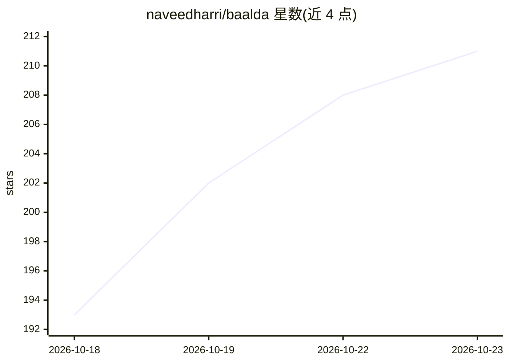

# naveedharri/baalda

⭐ 211 · HTML · Apache-2.0 · 推送 2026-10-22 · [GitHub](https://github.com/naveedharri/baalda) · [官网](https://baalda.com) · 组织维护

**本地 Markdown 团队笔记应用：AI 可像队友一样读写笔记**

基于 Tauri v2（Rust + React）的本地优先桌面笔记应用：笔记为磁盘上的纯 .md 文件，通过 Yjs CRDT + Hocuspocus 实现实时多人协作（实时光标、文件夹级权限），磁盘文件与 CRDT 状态双向同步、按操作合并而非整文件覆盖。AI 接入两条路径：本地 agent（如 Claude Code）直接编辑文件；云端 agent 走内置 MCP 端点（read_note/edit_note/search_notes 等工具，受与人相同的权限约束）。支持自托管（Node + Postgres，含 Docker Compose 与 Railway 部署）或使用官方托管服务；托管后端为商业服务，桌面应用开源（Apache 2.0）。需从源码构建运行。

## 筛选速览

| 维度 | 判定 | 备注 |
|---|---|---|
| AI 角色 | `ai-enhanced` | 去掉 AI 部分产品仍成立 |
| 许可风险 | `permissive` | Apache-2.0 |
| 部署形态 | `self-host` | docker 或自建部署 |
| 模型依赖 | — | README 未给出锁定关系 |
| 硬件要求 | — | 无带数字的原话,不猜 |
| 安装摩擦 | `low` | 无编译、无系统依赖或容器化 |
| 成熟度 | — | 结构信号不足 |

## 能力要点

- 磁盘 .md 文件为真相源，CRDT 操作双向同步合并人与 AI 的编辑
- 内置 MCP 端点供云端 agent 读写笔记，权限与人类一致
- 实时多人协作：实时光标、文件夹/单文件级共享权限
- SQLite FTS5 全文搜索、反向链接与标签，索引全部本地派生可重建

## 适用场景

- 团队共享一个 AI 可直接读写的 Markdown 知识库
- 本地 agent（如 Claude Code）直接编辑笔记并实时同步给团队
- 自托管团队笔记与同步服务，避免数据锁定

## 场景标签

`知识库管理` · 领域:知识与检索

## 证据(README 行号)

> L18: Baalda is a local-first desktop app for notes and knowledge: your second brain. Every note is a plain `.md` file on
> L20: - **Editable by AI.** Because notes are plain files, a local agent like Claude Code edits them right on your disk w
> L41: - 🤖 **AI-editable, two ways.** Local-first means a local agent (Claude Code, Codex, any CLI tool) edits the `.md` f

## 星数曲线

2026-10-18 193 → 2026-10-23 211（+18）

---
*卡片 v1 · prompt 1.4 · 生成 2026-10-22 · 置信度 mid · 依据 README sha `0d435090cb2b` · [字段定义](../../DATASET.md)*
