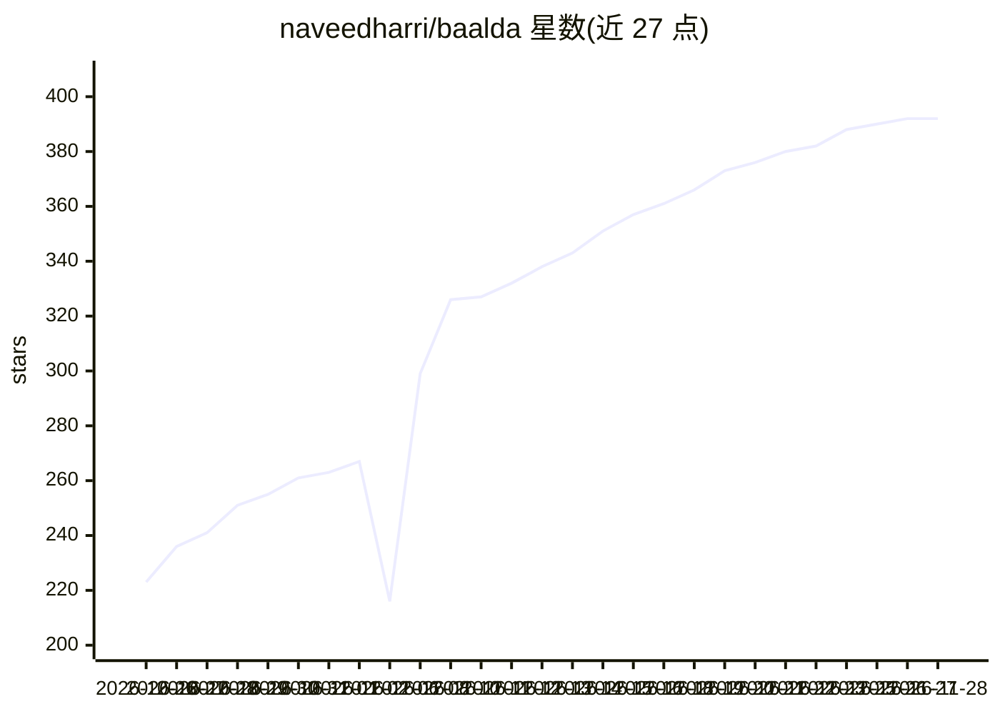

# naveedharri/baalda

⭐ 392 · HTML · Apache-2.0 · 推送 2026-11-27 · [GitHub](https://github.com/naveedharri/baalda) · [官网](https://baalda.com) · 组织维护

**团队的本地 Markdown 第二大脑，AI 可读写并实时协作**

本地优先的桌面笔记与知识库应用：笔记为磁盘上的纯 .md 文件，通过磁盘文件与 CRDT 之间的双向操作桥实现人机编辑合并与实时协同。AI 接入有两条路径——本地 agent 直接编辑文件（文件监听器同步变更），云端/自主 agent 经内置 MCP 端点按与人相同的权限读写。技术栈为 Tauri v2 + Rust + React + Postgres + Yjs/Hocuspocus。可下载安装包，也可自建（Node/Rust/Docker），或使用官方托管后端。

## 筛选速览

| 维度 | 判定 | 备注 |
|---|---|---|
| AI 角色 | `ai-enhanced` | 去掉 AI 部分产品仍成立 |
| 许可风险 | `permissive` | Apache-2.0 |
| 部署形态 | `self-host` | docker 或自建部署 |
| 模型依赖 | — | README 未给出锁定关系 |
| 硬件要求 | — | 无带数字的原话,不猜 |
| 安装摩擦 | `low` | 无编译、无系统依赖或容器化 |
| 成熟度 | — | 结构信号不足 |

## 能力要点

- 纯 .md 文件为事实来源，同时支持实时协作（CRDT 操作合并而非整文件覆盖）
- AI 可编辑：本地 CLI agent 直接改文件，云端 agent 经 MCP 端点受同套文件夹权限约束
- 本地全文搜索（SQLite FTS5）、反向链接与标签索引
- 自托管（Tauri+Node+Postgres），支持 Docker Compose 一键部署

## 适用场景

- 团队把共享知识库放在自己的磁盘与服务器上
- 让 Claude Code 等 agent 像队友一样读写团队笔记
- 多人实时协同编辑同一份 Markdown 笔记

## 场景标签

`知识库管理` · 领域:知识与检索

## 证据(README 行号)

> L18: Baalda is a local-first desktop app for notes and knowledge: your second brain. Every note is a plain `.md` file on
> L41: - 🤖 **AI-editable, two ways.** Local-first means a local agent (Claude Code, Codex, any CLI tool) edits the `.md` f

## 星数曲线

2026-10-26 223 → 2026-11-28 392（+169）

---
*卡片 v1 · prompt 1.4 · 生成 2026-11-25 · 置信度 high · 依据 README sha `1e983c0e6022` · [字段定义](../../DATASET.md)*
