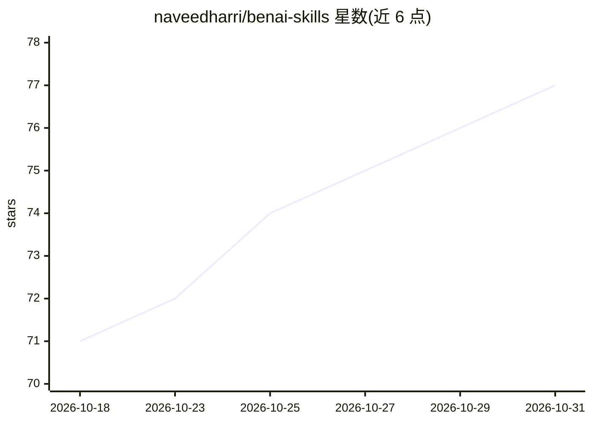

# naveedharri/benai-skills

⭐ 77 · JavaScript · MIT · 推送 2026-10-09 · [GitHub](https://github.com/naveedharri/benai-skills) · 个人维护

**面向 Claude Code 的部门化业务自动化技能集合（60+ 技能）**

以 Claude Code 插件市场形式安装的自动化技能库，按 Marketing、Sales、Operations、Creative、Product、YouTube、Marketing OS、Baalda OS 等部门组织 60 余个斜杠命令技能与若干子代理。功能覆盖程序化 SEO（148 规则技术审计、Search Console 三种数据路径）、B2B 外呼管线（四个并行子代理）、YouTube 五阶段发布链、n8n 工作流 REST 自动化、FFmpeg/Remotion 视频剪辑与 Gemini 信息图生成。部分技能需在 .env 配置 GEMINI_API_KEY、APIFY_TOKEN、N8N_API_KEY 等。

## 筛选速览

| 维度 | 判定 | 备注 |
|---|---|---|
| AI 角色 | `ai-knowledge` | 知识聚合/清单类 |
| 许可风险 | `permissive` | MIT |
| 部署形态 | `None` |  |
| 模型依赖 | — | README 未给出锁定关系 |
| 硬件要求 | — | 无带数字的原话,不猜 |
| 安装摩擦 | `medium` | 含编译或系统依赖之一 |
| 成熟度 | — | 结构信号不足 |

## 能力要点

- 按部门组织的 60+ 技能与子代理，经 Claude Code 插件市场安装
- Marketing OS：构建十文件夹 markdown 第二大脑与六标签仪表盘
- B2B 外呼管线编排 lead-qualifier/lead-researcher/linkedin-scraper/icebreaker-writer 四个子代理
- YouTube 发布链五阶段含四次人工检查点，借助 Claude in Chrome 读写 Studio

## 适用场景

- 在 Claude Code 中一键调用营销/销售/YouTube 自动化工作流
- 搭建并维护作为单一事实来源的 Marketing OS 第二大脑
- 从发现通话记录生成 n8n 自动化蓝图并经 REST API 部署

## 场景标签

`工作流自动化` · 领域:效率与自动化

## 证据(README 行号)

> L3: Expert automation skills for Claude Code, organized by department.
> L39: ### Marketing (11 skills)
> L56: ### BenAI Sales (14 skills)

## 星数曲线

2026-10-18 71 → 2026-10-31 77（+6）

---
*卡片 v1 · prompt 1.4 · 生成 2026-10-24 · 置信度 high · 依据 README sha `4a6fefe200cf` · [字段定义](../../DATASET.md)*
