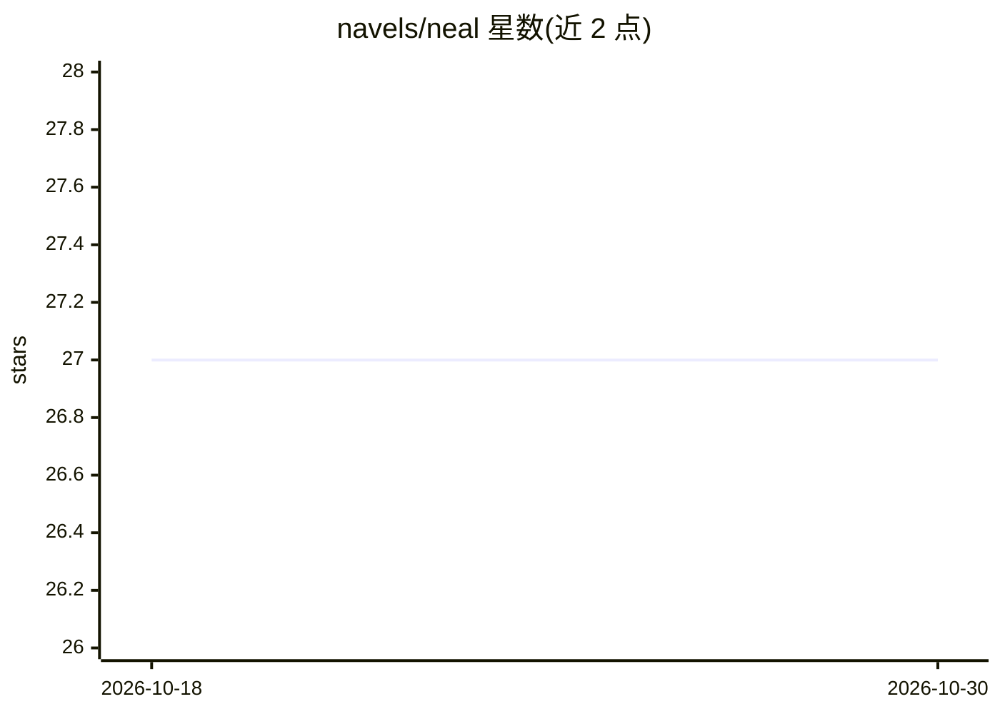

# navels/neal

⭐ 27 · TypeScript · MIT · 推送 2026-10-28 · [GitHub](https://github.com/navels/neal) · 个人维护

**规划驱动的多智能体编码循环工具：planner/coder/reviewer 协作实现计划**

面向仓库内编码任务的本地多智能体循环 CLI。用户撰写计划文档，neal 经 planner/reviewer 循环将其细化为带执行形态与可管理 scope 的执行计划，再逐 scope 由配置的 coder/reviewer（可跨厂商选模型）执行，scope 过大可自动拆分子计划，全部完成后做整体审查。运行状态与产物记录在 .neal/ 目录，支持 neal resume 断点续跑。reviewer 只读，在 provider 层机械强制。以 npm 全局包提供，需 Node.js >= 24.18.0。

## 筛选速览

| 维度 | 判定 | 备注 |
|---|---|---|
| AI 角色 | `ai-ecosystem` | LLM/agent 周边工具 |
| 许可风险 | `permissive` | MIT |
| 部署形态 | `library` | 以包/库形式分发 |
| 模型依赖 | local-ok | 支持本地模型 |
| 硬件要求 | — | 无带数字的原话,不猜 |
| 安装摩擦 | `low` | 无编译、无系统依赖或容器化 |
| 成熟度 | — | 结构信号不足 |

## 能力要点

- planner/coder/reviewer 三角色独立配置，可混用厂商与模型
- reviewer 只读并在各 adapter 中机械强制（沙箱/工具白名单/jailed 工具集）
- 运行状态与产物记录于 .neal/，neal resume 断点续跑
- neal compat 测试 OpenAI 兼容模型能否胜任三角色并输出 PASS/FAIL 白名单

## 适用场景

- 把前端升级等大型重构拆成小 scope 逐段执行避免上下文漂移
- 让一个厂商的模型编码、另一个厂商的模型做对抗式审查
- 对已提交的提交范围做计划外代码审查（neal review）

## 场景标签

`编码 Agent` `多智能体` `代码审查` · 领域:Agent 开发

## 证据(README 行号)

> L10: > **A plan-driven, multi-agent coding loop.** Separate **planner**, **coder**, and **reviewer** roles, each on the 
> L31: - **Roles, not one monolithic agent.** Planner, coder, and reviewer are independent, separately configurable roles.

## 星数曲线

2026-10-18 27 → 2026-10-30 27（+0）

---
*卡片 v1 · prompt 1.4 · 生成 2026-10-26 · 置信度 high · 依据 README sha `4b967c9040ed` · [字段定义](../../DATASET.md)*
