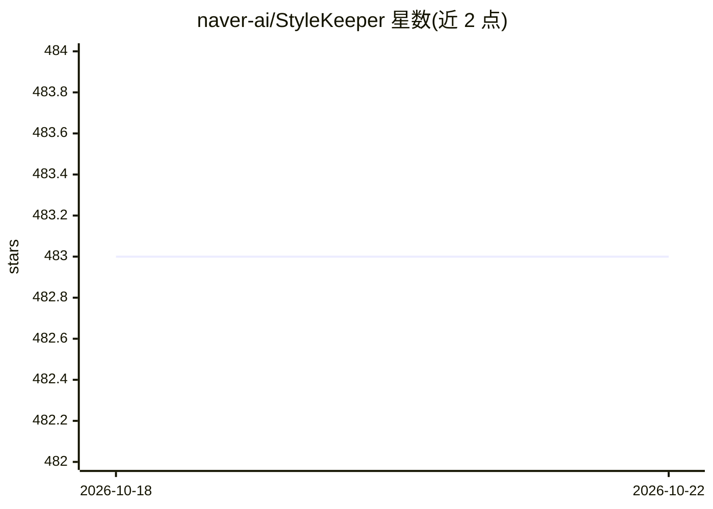

# naver-ai/StyleKeeper

⭐ 482 · Python · Apache-2.0 · 推送 2025-12-02 · [GitHub](https://github.com/naver-ai/StyleKeeper) · [官网](https://curryjung.github.io/VisualStylePrompt/) · 组织维护

**扩散模型免训练视觉风格化生成方法（ICCV 2025 论文官方实现）**

NAVER AI Lab 与延世大学发布的 StyleKeeper/VSP 论文 PyTorch 官方实现：在扩散模型去噪过程中保留原图 query、将后段自注意力层的 key/value 与参考图特征交换，实现无需微调的风格迁移，并针对内容泄漏提出负向视觉 query 引导。支持预定义风格、ControlNet（边缘/深度）控制与用户实拍参考图（含色彩校准），提供注意力图可视化脚本与 HuggingFace 在线 Demo。运行需 PyTorch 1.13.1 及 diffusers 等依赖，StyleKeeper 版本在待办中尚未发布，当前代码为 VSP 部分。

## 筛选速览

| 维度 | 判定 | 备注 |
|---|---|---|
| AI 角色 | `ai-native` | 本体是模型或模型工具 |
| 许可风险 | `permissive` | Apache-2.0 |
| 部署形态 | `library` | 以包/库形式分发 |
| 模型依赖 | — | README 未给出锁定关系 |
| 硬件要求 | — | 无带数字的原话,不猜 |
| 安装摩擦 | `low` | 无编译、无系统依赖或容器化 |
| 成熟度 | — | 结构信号不足 |

## 能力要点

- 免微调：去噪时交换自注意力层的 key/value 实现视觉风格提示
- 支持 ControlNet 边缘/深度控制与用户实拍参考图（色彩校准）
- 提供注意力图保存与可视化脚本
- HuggingFace 在线 Demo（含 GPU 升级版本）

## 适用场景

- 文本生成图像时保持指定参考图的风格元素
- 结合 ControlNet 控制结构进行风格化生成
- 复现论文实验或分析自注意力在风格迁移中的作用

## 场景标签

`图像生成` · 领域:内容生成

## 证据(README 行号)

> L1: ## 🎨 StyleKeeper: Prevent Content Leakage using Negative Visual Query Guidance (ICCV 2025)
> L11: > *In the evolving domain of text-to-image generation, diffusion models have emerged as powerful tools in content c
> L31: > python vsp_script.py --style fire

## 星数曲线

2026-10-18 483 → 2026-10-22 483（+0）

---
*卡片 v1 · prompt 1.4 · 生成 2026-10-21 · 置信度 mid · 依据 README sha `3f7831e3cc1f` · [字段定义](../../DATASET.md)*
