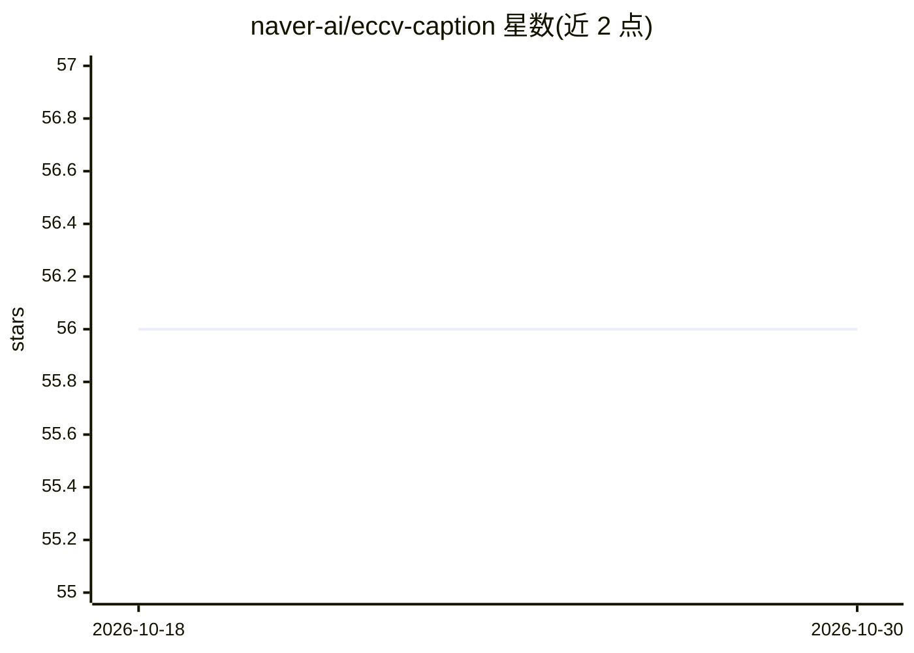

# naver-ai/eccv-caption

⭐ 56 · Python · NOASSERTION · 推送 2026-07-07 · [GitHub](https://github.com/naver-ai/eccv-caption) · 组织维护

**扩展 COCO 图文检索评测数据集与指标计算库（ECCV 2022）**

NAVER AI Lab 发布的 Extended COCO Validation (ECCV) Caption 数据集及配套 Python 库：通过 5 个图文匹配模型加 MTurk 人工标注，补充 MS-COCO Caption 中的假阴性关联（正样本图像 ×8.47、正样本描述 ×3.58）。库提供统一接口计算 COCO 1k/5k Recall@K、CxC Recall@K、PMRP、ECCV Recall@K、R-Precision 与 mAP@R 等检索指标，并对 25 个已有 VL 模型做了重评测。面向视觉-语言模型研究者的评测场景。

## 筛选速览

| 维度 | 判定 | 备注 |
|---|---|---|
| AI 角色 | `ai-knowledge` | 知识聚合/清单类 |
| 许可风险 | `none` | NOASSERTION |
| 部署形态 | `library` | 以包/库形式分发 |
| 模型依赖 | — | README 未给出锁定关系 |
| 硬件要求 | — | 无带数字的原话,不猜 |
| 安装摩擦 | `low` | 无编译、无系统依赖或容器化 |
| 成熟度 | — | 结构信号不足 |

## 能力要点

- 机器+人工验证的扩展标注：正样本图像 ×8.47、正样本描述 ×3.58
- 统一接口计算 COCO 1k/5k R@K、CxC R@K、PMRP、ECCV R@K、mAP@R 等指标
- 标注构建基于 VSRN/PVSE/ViLT/CLIP/PCME 五个模型 + MTurk 人工验证
- 提供 Google Drive 全量数据含原始标注与过滤清单

## 适用场景

- 评测图文匹配/跨模态检索模型的检索质量
- 比较 COCO R@K 与 mAP@R 指标下的模型排名差异
- 研究基准数据集假阴性对评测的影响

## 场景标签

`模型评测` · 领域:评测与运维

## 证据(README 行号)

> L9: ECCV Caption contains x8.47 positive images and x3.58 positive captions compared to the original COCO Caption. The p
> L17: Image-Text matching (ITM) is a common task for evaluating the quality of Vision and Language (VL) models. However, 
> L21: ECCV Caption dataset is an extended version of the COCO Caption test split by karpathy/neuraltalk2. We annotate pos

## 星数曲线

2026-10-18 56 → 2026-10-30 56（+0）

---
*卡片 v1 · prompt 1.4 · 生成 2026-10-24 · 置信度 high · 依据 README sha `a5af220488e2` · [字段定义](../../DATASET.md)*
