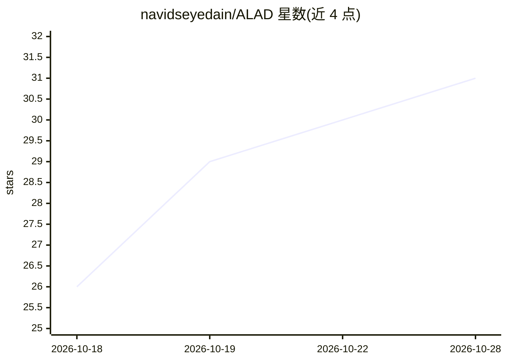

# navidseyedain/ALAD

⭐ 31 · JavaScript · MIT · 推送 2026-08-10 · [GitHub](https://github.com/navidseyedain/ALAD) · 个人维护

**Chrome 标签页实时 AI 语音配音扩展，支持 78 种语言**

基于 Manifest V3 的开源 Chrome 扩展：通过 chrome.tabCapture 捕获当前标签页音频，经 WebSocket 双向流式连接发送到 Gemini 3.5 Live Translate 模型，实时播放翻译后的语音配音，并自动静音/恢复原始音频。支持 YouTube、Twitch、播客等任何播放音频的标签页，覆盖 78 种目标语言。采用 BYOK 模式，用户自带 Gemini API key，使用统计（最多 2,000 个会话）全部本地存储，无账号无遥测。当前需以开发者模式手动加载安装，尚未上架 Chrome Web Store。

## 筛选速览

| 维度 | 判定 | 备注 |
|---|---|---|
| AI 角色 | `ai-native` | 本体是模型或模型工具 |
| 许可风险 | `permissive` | MIT |
| 部署形态 | `None` |  |
| 模型依赖 | — | README 未给出锁定关系 |
| 硬件要求 | — | 无带数字的原话,不猜 |
| 安装摩擦 | `low` | 无编译、无系统依赖或容器化 |
| 成熟度 | `idea` | |

## 能力要点

- 实时双向流式语音翻译（WebSocket 连接 Gemini API）
- 78 种目标语言，任意播放音频的标签页均可配音
- BYOK：用户自带 Gemini API key，零遥测、数据本地存储
- 本地使用统计面板：热力图、时段分布、语言/域名统计

## 适用场景

- 看外语视频时不用字幕直接听到母语配音
- 实时听懂外语播客、网课或直播内容
- 语言学习者和旅行者跨语言消费在线内容

## 场景标签

`语音合成` · 领域:内容生成

## 证据(README 行号)

> L26: **ALAD (AI Live Audio Dubbing)** is a free, open-source Chrome extension that breaks the language barrier for any c
> L39: - **Real-time bidirectional streaming** via WebSocket to the Gemini API — ultra-low latency

## 星数曲线

2026-10-18 26 → 2026-10-28 31（+5）

---
*卡片 v1 · prompt 1.4 · 生成 2026-10-26 · 置信度 high · 依据 README sha `19709ec9e209` · [字段定义](../../DATASET.md)*
