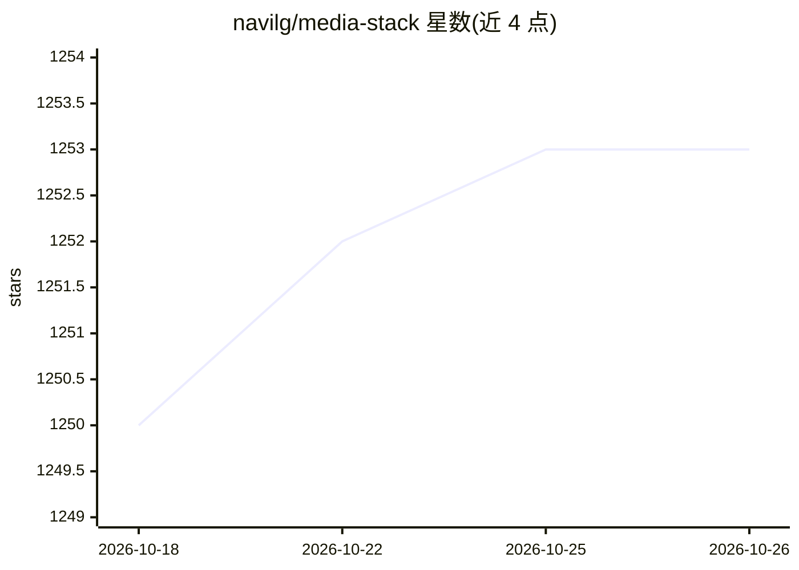

# navilg/media-stack

⭐ 1,253 · GPL-3.0 · 推送 2026-10-10 · [GitHub](https://github.com/navilg/media-stack) · 个人维护

**自托管媒体管理与流媒体全家桶，可选 AI 影视推荐**

基于 Docker Compose 的一体式自托管媒体栈，整合 Radarr（电影管理）、Sonarr（剧集管理）、Prowlarr（种子索引器）、qBittorrent（下载）、Seerr（媒体请求管理）与 Jellyfin（开源流媒体），并通过 Gluetun 容器让下载流量走 VPN（默认 NordVPN，支持 ExpressVPN/SurfShark/ProtonVPN/OpenVPN/WireGuard，均用 OpenVPN 协议）。可选启用 Recommendarr，基于 Sonarr/Radarr/Jellyfin/Trakt 库与观看记录、调用 OpenAI 兼容 API 生成个性化影视推荐。面向 homelab 用户，需 Docker 28.0.1+ 与 Docker Compose v2.33.1+，提供 Nginx 反向代理与 SSL 配置步骤；Jellyfin 12 升级不可回滚需全量备份。

## 筛选速览

| 维度 | 判定 | 备注 |
|---|---|---|
| AI 角色 | `ai-enhanced` | 去掉 AI 部分产品仍成立 |
| 许可风险 | `viral` | GPL-3.0 |
| 部署形态 | `self-host` | docker 或自建部署 |
| 模型依赖 | local-ok | 支持本地模型 |
| 硬件要求 | — | 无带数字的原话,不猜 |
| 安装摩擦 | `low` | 无编译、无系统依赖或容器化 |
| 成熟度 | — | 结构信号不足 |

## 能力要点

- docker compose 单命令部署 7+ 个媒体管理组件
- 下载流量经 Gluetun 走 VPN，支持 6 类 VPN 提供商
- Recommendarr 基于 Jellyfin 观看历史与媒体库生成 AI 推荐
- Nginx 反向代理与 certbot SSL 配置指引

## 适用场景

- 在家用服务器搭建自动化的影视下载管理与流媒体库
- 让下载与索引流量经 VPN 保护隐私
- 根据观看历史获取 AI 生成的影视推荐

## 场景标签

 · 领域:自托管媒体服务器

## 证据(README 行号)

> L5: A self-hosted media ecosystem that combines media management, streaming, AI-powered recommendations, and VPN.
> L42: 3. **With Recommendarr** (An optional tool for AI-generated movie and show recommendations)

## 星数曲线

2026-10-18 1,250 → 2026-10-26 1,253（+3）

---
*卡片 v1 · prompt 1.4 · 生成 2026-10-21 · 置信度 high · 依据 README sha `4cc2484a4cd5` · [字段定义](../../DATASET.md)*
