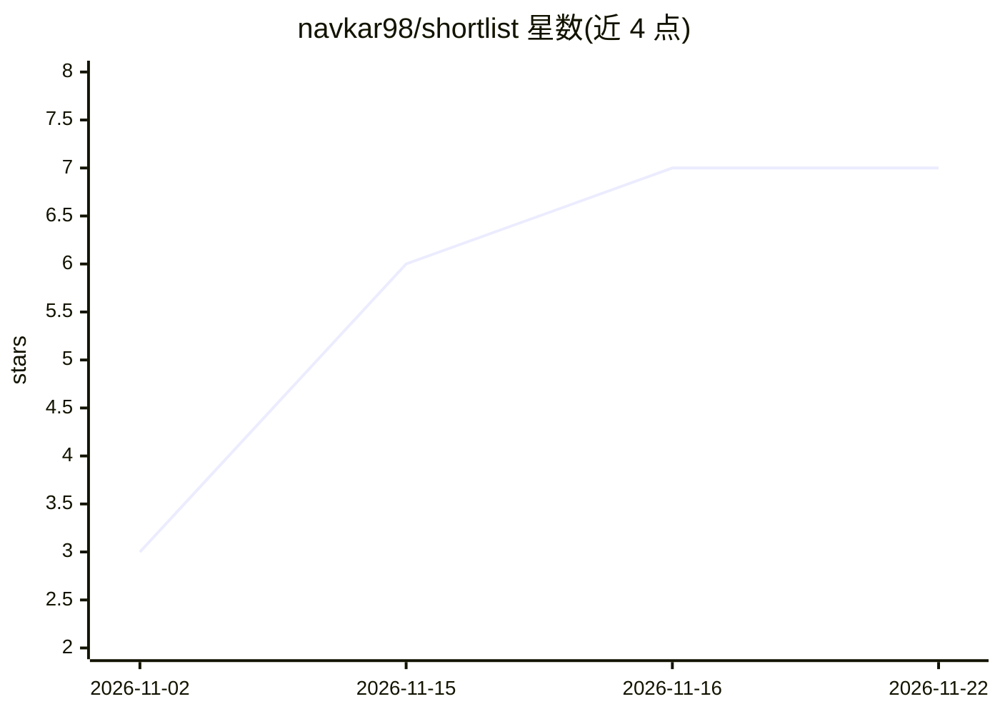

# navkar98/shortlist

⭐ 7 · Python · MIT · 推送 2026-11-15 · [GitHub](https://github.com/navkar98/shortlist) · 个人维护

**个人求职者：LLM 按简历筛选新职位并推送到 Telegram**

在本地运行的个人求职监控工具：读取 Greenhouse、Lever、Ashby、Workday 等职位板公开 API 与 GitHub 职位列表，先用标题/地点规则过滤，再用 LLM 结合 resume.md 与偏好对每个新职位打 0-100 分，超过阈值的通过 Telegram 推送或存入自带 Web 应用。支持 Claude Code/OpenAI Codex CLI 或 Anthropic/OpenAI API 作为评分后端，可选 agent 代填申请表（默认停在提交按钮），提供登录定时任务、礼貌抓取与成本控制。需 Python 3.11+ 与 Git，本机运行，无服务器。

## 筛选速览

| 维度 | 判定 | 备注 |
|---|---|---|
| AI 角色 | `ai-native` | 本体是模型或模型工具 |
| 许可风险 | `permissive` | MIT |
| 部署形态 | `library` | 以包/库形式分发 |
| 模型依赖 | — | README 未给出锁定关系 |
| 硬件要求 | — | 无带数字的原话,不猜 |
| 安装摩擦 | `low` | 无编译、无系统依赖或容器化 |
| 成熟度 | — | 结构信号不足 |

## 能力要点

- LLM 结合 resume.md 与偏好对职位打 0-100 分并给出匹配/缺失技能
- 职位板自动发现与 CSS 配方缓存，仅对未评分职位调用模型
- Telegram 推送与自带 Web 应用（匹配浏览、申请看板、设置）
- 可选 agent 代填申请表，默认留提交按钮给用户确认

## 适用场景

- 关注的多家公司有新职位发布时按简历匹配度收到推送
- 跟踪投递进度并导出申请记录
- 让 agent 帮忙代填重复的申请表单，自己确认提交

## 场景标签

`工作流自动化` `推荐系统` · 领域:效率与自动化

## 证据(README 行号)

> L3: Shortlist watches the job boards of the companies you care about, scores every new opening against your resume
> L13: 4. scores each **new** job against `resume.md` and your preferences (every job is scored at most once, ever),
> L119: You need Python 3.11 or newer and Git. For scoring you need one of: Claude Code

## 星数曲线

2026-11-02 3 → 2026-11-22 7（+4）

---
*卡片 v1 · prompt 1.4 · 生成 2026-11-21 · 置信度 mid · 依据 README sha `d97538107975` · [字段定义](../../DATASET.md)*
