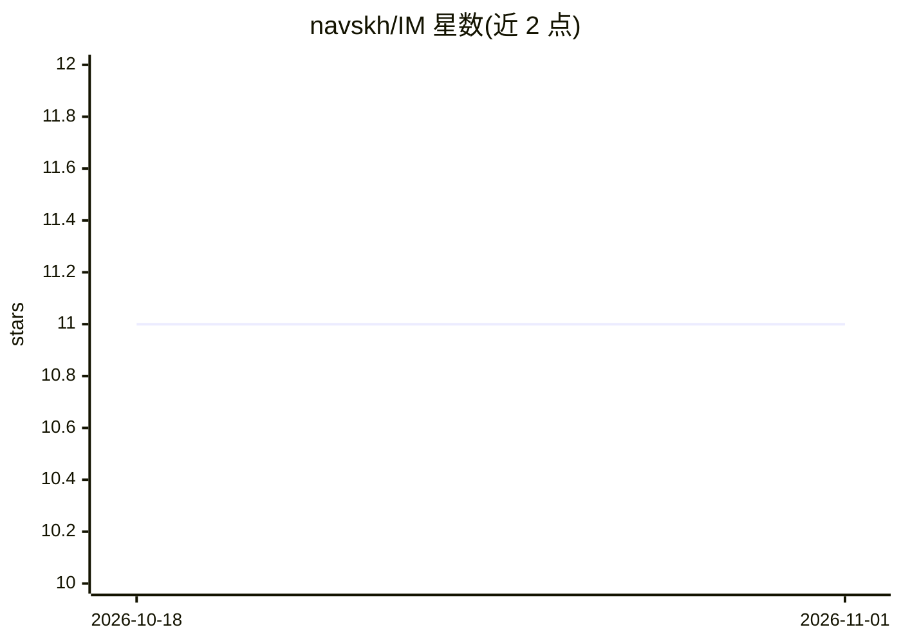

# navskh/IM

⭐ 11 · TypeScript · 推送 2026-04-22 · [GitHub](https://github.com/navskh/IM) · 个人维护 · 中文 README

**面向开发者的本地优先想法与任务管理器，可交接给 AI agent 执行**

npm 全局安装的 CLI 工具，启动 Web UI（Chrome/Edge app 模式）。核心机制：自由头脑风暴笔记 → 项目/任务树 → 每任务富 Markdown 笔记（CodeMirror 编辑器、⌘K AI 命令面板、上下文补全）→ 通过 Watch 模式自动调用所选 AI CLI（Claude/Gemini/Codex）执行任务。内置 MCP Server（stdio）向外部 agent 暴露 list-projects、get-next-task 等工具，任务数据存于本地 SQLite，跨机同步走私有 Git 仓库。需 Node.js 18+；AI CLI 为可选项，核心任务管理不依赖它。README 含多语言版本与韩语 AI 命令示例。

## 筛选速览

| 维度 | 判定 | 备注 |
|---|---|---|
| AI 角色 | `ai-enhanced` | 去掉 AI 部分产品仍成立 |
| 许可风险 | `none` | — |
| 部署形态 | `library` | 以包/库形式分发 |
| 模型依赖 | locked-api |  |
| 硬件要求 | — | 无带数字的原话,不猜 |
| 安装摩擦 | `low` | 无编译、无系统依赖或容器化 |
| 成熟度 | — | 结构信号不足 |

## 能力要点

- 头脑风暴 → 任务树 → AI agent 执行的工作流与自动分发（Auto Distribute）
- 内置 MCP Server，向 Claude Desktop/Claude Code 等外部 agent 暴露 7 个任务工具
- Watch 模式按项目自动执行已提交任务并流式输出
- 本地优先 SQLite（sql.js 纯 JS，无原生依赖）+ Git 跨机同步

## 适用场景

- 把零散的想法整理成结构化任务并自动交接给 AI CLI 执行
- 通过 MCP 让 Claude Desktop 等外部 agent 读取和推进任务
- 多台机器间同步本地的项目与任务数据

## 场景标签

`知识库管理` `工作流自动化` · 领域:效率与自动化

## 证据(README 行号)

> L9: A local-first task management tool for developers. Organize ideas into workspaces and projects, refine prompts for e
> L173: - **AI CLI** (optional) — Claude CLI, Gemini CLI, or Codex CLI for AI features. Core task management works without

## 星数曲线

2026-10-18 11 → 2026-11-01 11（+0）

---
*卡片 v1 · prompt 1.4 · 生成 2026-11-01 · 置信度 high · 依据 README sha `bf0f2ce460d0` · [字段定义](../../DATASET.md)*
