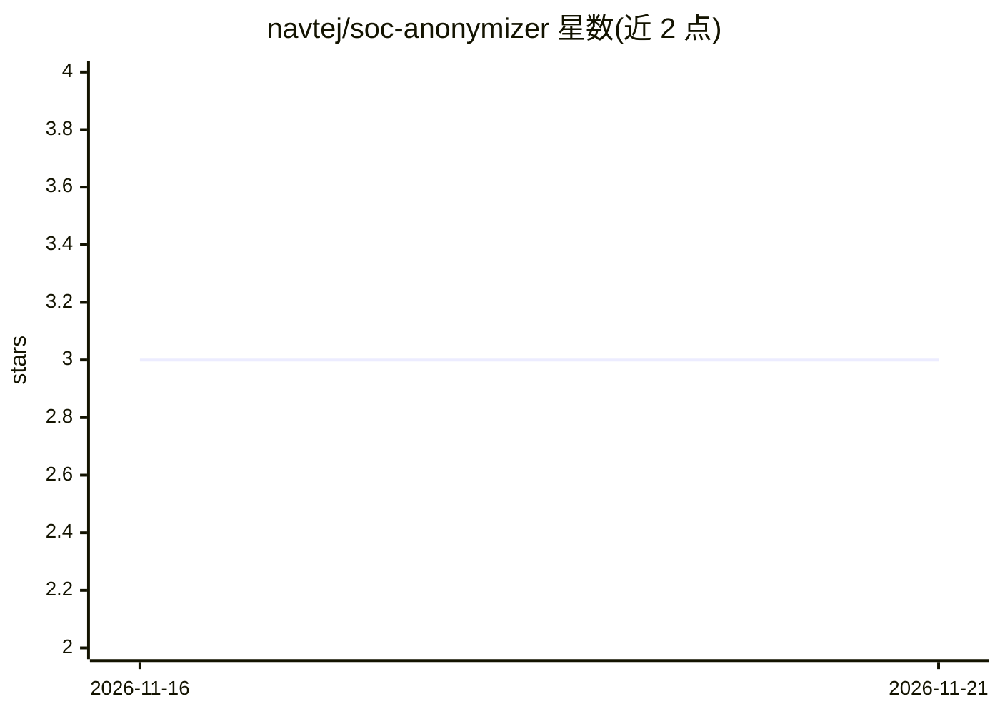

# navtej/soc-anonymizer

⭐ 3 · Python · 推送 2026-10-30 · [GitHub](https://github.com/navtej/soc-anonymizer) · 个人维护

**SOC 安全导出数据的本地离线匿名化脚本工具**

针对 Jira 工单、Microsoft Sentinel/Defender 告警、SIEM 日志（Wazuh/Elastic 等）、Azure/AWS 日志的本地匿名化脚本：按身份列→词库→正则→GLiNER2 NER→可选本地 LLM 复审的分层检测替换敏感值，并生成确定性 HMAC 假名使关联关系在文件与运行间保持。流式处理支持多 GB 文件，支持 --resume 续跑与完成性保障。另附随机抽样脚本用于试运行。Python ≥3.10，可用 uv 或 venv/pip 运行，全部数据留在本地。

## 筛选速览

| 维度 | 判定 | 备注 |
|---|---|---|
| AI 角色 | `ai-enhanced` | 去掉 AI 部分产品仍成立 |
| 许可风险 | `none` | — |
| 部署形态 | `library` | 以包/库形式分发 |
| 模型依赖 | local-ok | 支持本地模型 |
| 硬件要求 | — | 无带数字的原话,不猜 |
| 安装摩擦 | `medium` | 含编译或系统依赖之一 |
| 成熟度 | — | 结构信号不足 |

## 能力要点

- 确定性假名：同一实体在所有列、文件、运行中得到相同 token（HMAC+密钥）
- 分层检测：身份列→词库→正则（邮箱/IP/GUID/密钥/ARN 等）→GLiNER2 NER→可选本地 LLM 复审
- 流式处理多 GB CSV/NDJSON/JSON/XLSX，支持 --resume 续跑且结果与不间断运行字节一致
- 默认拒绝远程端点，LLM 复审仅限本地 OpenAI 兼容服务器

## 适用场景

- 把 Jira/Sentinel/SIEM 导出脱敏后交给 LLM 或厂商分析
- 多 GB 安全日志在有限内存机器上批量匿名化
- 运行中断后用 --resume 继续匿名化任务
- 对真实导出先抽小比例样本做试运行

## 场景标签

`网络安全` · 领域:学习与行业

## 证据(README 行号)

> L14:  paths, AWS ARNs/account ids, internal FQDNs …) → GLiNER2-PII NER on prose → optional local
> L190: |`--no-ner`|off|Rules and lexicon only: fast, no model|
> L16: - **Everything runs locally.** The NER model is downloaded once; the optional reviewer talks to

## 星数曲线

2026-11-16 3 → 2026-11-21 3（+0）

---
*卡片 v1 · prompt 1.4 · 生成 2026-11-21 · 置信度 mid · 依据 README sha `52373c987726` · [字段定义](../../DATASET.md)*
