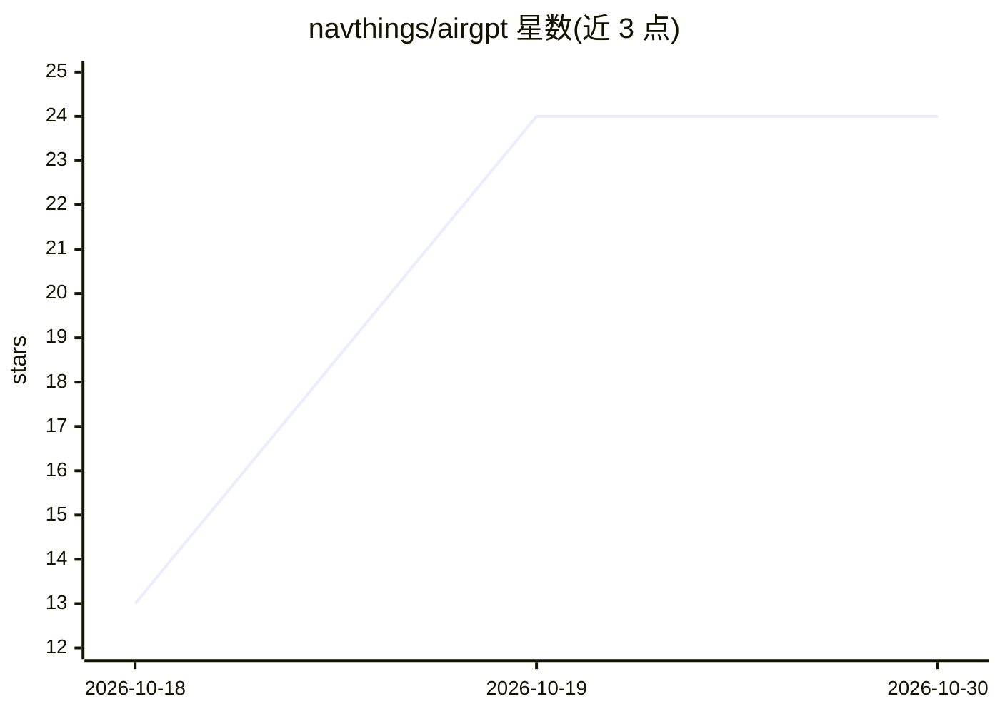

# navthings/airgpt

⭐ 24 · Python · MIT · 推送 2026-10-19 · [GitHub](https://github.com/navthings/airgpt) · 个人维护

**在 Mac 上从零训练个人聊天机器人的工具**

基于 Apple MLX 框架的从零训练工具：一条命令完成数据下载（TinyStories/Cosmopeda）、字节级 BPE 分词器训练、llama 风格 Transformer 预训练与对话微调，并可用 chat.py 对话。提供 smoke/hour/night 三档预设（3 分钟/1 小时 8M/8 小时 40M），学习率按时间调度以适配机器速度，训练中监控热状态并在过热时暂停 30 秒。也支持从 Hugging Face 下载已训练模型直接运行。面向无 NVIDIA GPU 的 Mac 用户；8M 模型的对话质量自述较差。

## 筛选速览

| 维度 | 判定 | 备注 |
|---|---|---|
| AI 角色 | `ai-native` | 本体是模型或模型工具 |
| 许可风险 | `permissive` | MIT |
| 部署形态 | `library` | 以包/库形式分发 |
| 模型依赖 | — | README 未给出锁定关系 |
| 硬件要求 | — | 无带数字的原话,不猜 |
| 安装摩擦 | `low` | 无编译、无系统依赖或容器化 |
| 成熟度 | — | 结构信号不足 |

## 能力要点

- 单命令完成数据下载、分词器训练、预训练与对话微调全流程
- 按时间而非步数调度的学习率（慢机器也能按时完成）
- 内置 BPE 分词器与 llama 风格 Transformer（RoPE/GQA/SwiGLU/KV cache）均从零实现
- 热状态监控、自动暂停、中断保存与恢复

## 适用场景

- 在没有 NVIDIA GPU 的 MacBook 上体验从零训练 LLM 全流程
- 用自有文本文件或自定义数据混合训练小模型
- 对比不同 Mac 芯片的训练速度（bench.py）与参与 speedrun 排行

## 场景标签

`模型训练` `聊天机器人` · 领域:对话与助手

## 证据(README 行号)

> L22: that one command downloads data, trains a tokenizer, pretrains a model, finetunes it for chat and lets you talk to 
> L121: 2. pretrains a llama-style transformer on that text, which is where it learns english
> L123: 4. `chat.py` lets you talk to it

## 星数曲线

2026-10-18 13 → 2026-10-30 24（+11）

---
*卡片 v1 · prompt 1.4 · 生成 2026-10-27 · 置信度 mid · 依据 README sha `5f29b92144e0` · [字段定义](../../DATASET.md)*
