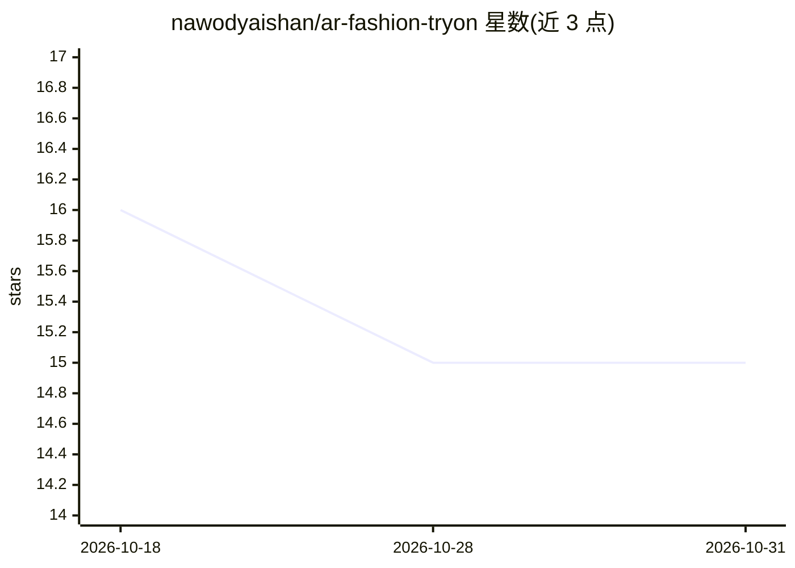

# nawodyaishan/ar-fashion-tryon

⭐ 15 · Python · MIT · 推送 2026-10-20 · [GitHub](https://github.com/nawodyaishan/ar-fashion-tryon) · [官网](https://ar-fashion-tryon.vercel.app) · 个人维护

**面向购物者的虚拟试衣应用：AR 实时预览与照片试穿生成**

由 Next.js 前端、Railway 上的 FastAPI 服装处理 API、Cloudinary 存储分发和 Hugging Face GPU Space 上的 CatVTON 推理服务组成。支持三种照片试穿模式（普通、整套、参考）与浏览器相机驱动的 AR 实时叠加（MediaPipe Pose + Three.js）。后端包含 TensorFlow CNN 服装分类、U²-Net 背景去除和 OpenCV 套装合成。本地开发需 macOS/Linux、Node 22、Python 3.11、Cloudinary 凭证；本地推理需另配 GPU。

## 筛选速览

| 维度 | 判定 | 备注 |
|---|---|---|
| AI 角色 | `ai-native` | 本体是模型或模型工具 |
| 许可风险 | `permissive` | MIT |
| 部署形态 | `None` |  |
| 模型依赖 | — | README 未给出锁定关系 |
| 硬件要求 | — | 无带数字的原话,不猜 |
| 安装摩擦 | `low` | 无编译、无系统依赖或容器化 |
| 成熟度 | — | 结构信号不足 |

## 能力要点

- CatVTON 潜在扩散模型生成照片试穿结果（DensePose/SCHP 预处理）
- MediaPipe Pose 驱动的 Three.js 浏览器 AR 服装叠加
- TensorFlow CNN 服装分类 + U²-Net 背景去除 + OpenCV 套装合成
- Makefile 驱动的可复现开发流程与 CI 验证

## 适用场景

- 上传人物与服装照片生成试穿效果图
- 用浏览器摄像头实时预览服装上身效果
- 组合上下装生成整套穿搭试穿

## 场景标签

`图像生成` · 领域:内容生成

## 证据(README 行号)

> L20: Preview clothing with live camera overlays or generate a photo try-on from person and garment images. The applicati
> L33: - **AI inference (Hugging Face Space, GPU):** CatVTON pre-processing (DensePose and SCHP) followed by latent diffus

## 星数曲线

2026-10-18 16 → 2026-10-31 15（-1）

---
*卡片 v1 · prompt 1.4 · 生成 2026-10-30 · 置信度 high · 依据 README sha `1a7841b6e774` · [字段定义](../../DATASET.md)*
