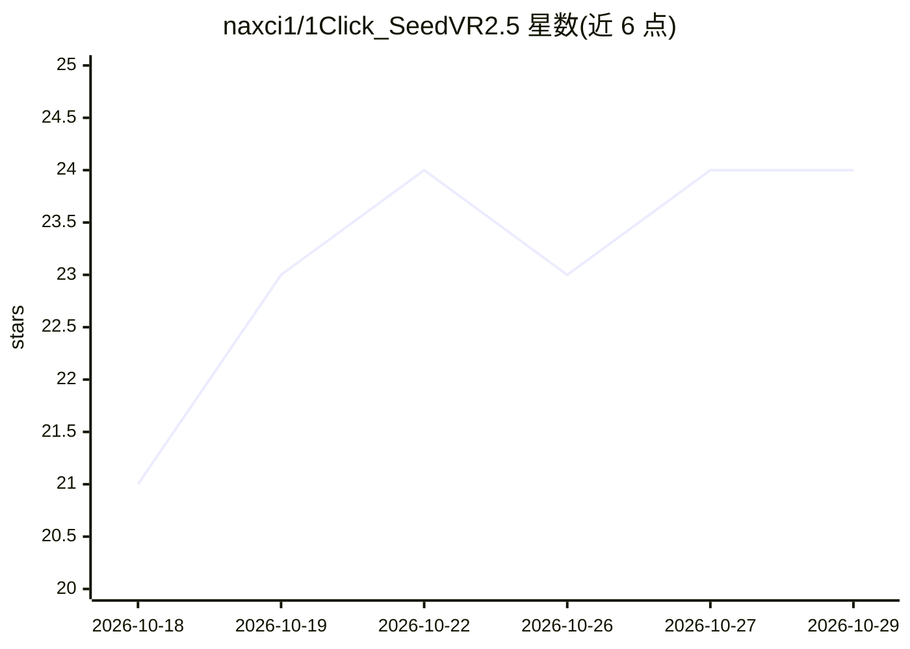

# naxci1/1Click_SeedVR2.5

⭐ 24 · Apache-2.0 · 推送 2026-10-23 · [GitHub](https://github.com/naxci1/1Click_SeedVR2.5) · [官网](https://www.youtube.com/@1Click_SeedVR2.5) · 个人维护

**给普通用户的 SeedVR2 AI 视频/图像修复放大桌面 GUI**

基于 ByteDance SeedVR2 扩散变换器（DiT）架构的桌面图形界面，将视频与图像的修复放大流程封装为面板、下拉框与实时对比预览操作，覆盖单帧到多小时影片处理。机制上提供多阶段 DiT→VAE 解码→编码管线、GGUF/FP8/FP16 多档量化模型选择、可选 TensorRT VAE 解码、预览单帧对比、图像序列导出（TIFF/PNG/DPX/EXR）；支持 NVIDIA CUDA、AMD ROCm、Intel XPU 与 CPU 回退。README 仅覆盖 GUI 参考，命令行与环境安装不在文档范围内。

## 筛选速览

| 维度 | 判定 | 备注 |
|---|---|---|
| AI 角色 | `ai-native` | 本体是模型或模型工具 |
| 许可风险 | `permissive` | Apache-2.0 |
| 部署形态 | `None` |  |
| 模型依赖 | — | README 未给出锁定关系 |
| 硬件要求 | — | 无带数字的原话,不猜 |
| 安装摩擦 | `medium` | 含编译或系统依赖之一 |
| 成熟度 | — | 结构信号不足 |

## 能力要点

- 多阶段 DiT→VAE 解码→编码管线，含 tile 节流、批量降级等自动回退
- GGUF（Q4/Q8）、FP8、FP16 多档 3B/7B 模型可选，VAE 自动配对
- 可选 TensorRT VAE 解码，文档标注解码约 1.4× 加速
- 预览单帧放大并进入原片/结果分屏实时对比
- 输出覆盖 MP4/MOV/MKV/WEBM 与 16-bit TIFF/PNG/DPX/EXR 图像序列

## 适用场景

- 把老旧或低清视频、影像资料放大修复到高清/4K
- 先预览单帧效果对比原片再决定是否整片渲染
- 为存档母版导出 16-bit TIFF/ProRes 等无压缩损的图像序列

## 场景标签

`图像视频处理` · 领域:感知与多模态

## 证据(README 行号)

> L3: > · A high‑performance AI video restoration GUI built on the ByteDance **SeedVR2** architecture.
> L24: **1Click SeedVR2.5** is a high‑performance AI video‑restoration GUI optimized for the ByteDance **SeedVR2** diffusi
> L33: |**Native preview workflow**|A one‑click **Preview** captures a single frame, upscales it, and drops you straight i

## 星数曲线

2026-10-18 21 → 2026-10-29 24（+3）

---
*卡片 v1 · prompt 1.4 · 生成 2026-10-27 · 置信度 high · 依据 README sha `84b358feb5bb` · [字段定义](../../DATASET.md)*
