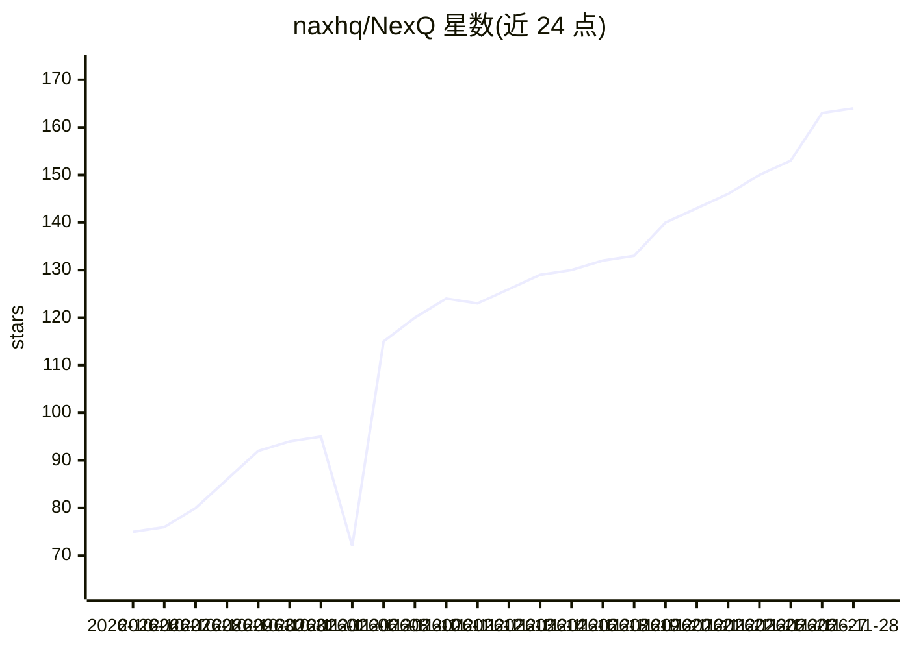

# naxhq/NexQ

⭐ 164 · Rust · MIT · 推送 2026-11-27 · [GitHub](https://github.com/naxhq/NexQ) · [官网](https://getnexq.com) · 组织维护

**开源会议 AI 助手：实时双端转写并基于你的笔记作答**

面向 Windows 与 macOS（beta）的会议助手，捕获麦克风与系统音频两条流，为每侧提供独立的语音识别引擎、语言与静音设置，实现双方分离的实时转写。基于工作区内的笔记、文档（本地 RAG 支持 PDF/DOCX/TXT/MD）生成带来源引用的回答，支持一键应答、自动应答与话术要点跟踪。支持 12 种语音识别引擎与 10 个 LLM 提供商，可完全本地离线运行，也可接入已有的 Claude/ChatGPT 订阅。MIT 许可，无账号、无遥测，安装包未签名/未公证，需绕过 SmartScreen 或 Gatekeeper。

## 筛选速览

| 维度 | 判定 | 备注 |
|---|---|---|
| AI 角色 | `ai-native` | 本体是模型或模型工具 |
| 许可风险 | `permissive` | MIT |
| 部署形态 | `desktop` | 安装包/桌面程序 |
| 模型依赖 | local-ok | 支持本地模型 |
| 硬件要求 | — | 无带数字的原话,不猜 |
| 安装摩擦 | `medium` | 含编译或系统依赖之一 |
| 成熟度 | — | 结构信号不足 |

## 能力要点

- 麦克风与系统音频双流分离转写，各侧独立引擎与语言
- 本地 RAG（SQLite FTS + embeddings）与带来源引用的工作区问答
- 12 种语音识别引擎、10 个 LLM 提供商、5 种翻译提供商，可全离线运行
- 无机器人入会、无账号、密钥存于 OS 凭据存储

## 适用场景

- 面试或网课中实时获得基于自己笔记的回答要点
- 为客户/课程/项目分别管理会议记录、文件与记忆
- 需要全程本地离线处理通话音频的场景
- 会后检索历史转写并生成摘要与行动项

## 场景标签

`AI 助手` `语音识别` `文档问答` · 领域:对话与助手

## 证据(README 行号)

> L7: **Free, open-source AI meeting assistant, with a workspace for every client, class and project.**
> L8: It transcribes both sides of a call live and answers from your own notes, with local models or the AI you already us
> L40: - **Bring your own models.** 12 speech-to-text engines and 10 LLM providers, including your existing Claude or Chat

## 星数曲线

2026-10-26 75 → 2026-11-28 164（+89）

---
*卡片 v1 · prompt 1.4 · 生成 2026-11-27 · 置信度 mid · 依据 README sha `29c80207f098` · [字段定义](../../DATASET.md)*
