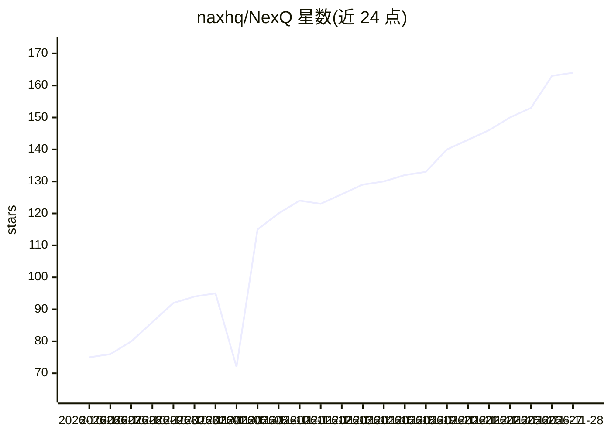

# naxhq/NexQ

⭐ 164 · Rust · MIT · 推送 2026-11-27 · [GitHub](https://github.com/naxhq/NexQ) · [官网](https://getnexq.com) · 组织维护

**本地优先的会议助手：实时转写双方语音并基于你的笔记作答**

面向 Windows 与 macOS（beta）的开源桌面应用（Tauri 2 构建），以 MIT 许可发布。将麦克风与系统音频分为两路分别转写，支持问题检测、按键或自动作答、实时翻译、要点提示、会议记录与摘要导出。3.0 版引入工作区机制，按客户、课程或项目隔离会议、文件与记忆，工作区聊天回答带引用并可追溯至会议时间点。支持 12 种语音转写引擎、10 个 LLM 提供商与 5 个翻译提供商，可全离线运行；密钥存于系统凭证存储，数据存于本地数据库。

## 筛选速览

| 维度 | 判定 | 备注 |
|---|---|---|
| AI 角色 | `ai-native` | 本体是模型或模型工具 |
| 许可风险 | `permissive` | MIT |
| 部署形态 | `desktop` | 安装包/桌面程序 |
| 模型依赖 | local-ok | 支持本地模型 |
| 硬件要求 | — | 无带数字的原话,不猜 |
| 安装摩擦 | `medium` | 含编译或系统依赖之一 |
| 成熟度 | `idea` | |

## 能力要点

- 麦克风与系统音频双路独立转写，可各自设置引擎、语言与静音
- 10 个 LLM 提供商与 12 种语音转写引擎，含 Ollama 自动发现与全离线预设
- 工作区隔离机制：会议、文件、记忆互不串扰，聊天回答带 [S1] 引用
- 本地 RAG 支持 PDF/DOCX/TXT/MD（SQLite FTS 加嵌入），可隐藏出屏共享

## 适用场景

- 面试、网课、讲座中实时获得基于自己笔记的回答
- 为客户或项目维护独立的会议记录与知识库
- 无机器人加入、可完全离线地进行通话转写与问答
- 会后检索、回放与导出带引用的会议摘要

## 场景标签

`语音识别` `RAG` `知识库管理` `AI 助手` · 领域:对话与助手

## 证据(README 行号)

> L7: **Free, open-source AI meeting assistant, with a workspace for every client, class and project.**
> L42: - **Bring your own models.** 12 speech-to-text engines and 10 LLM providers, including your existing Claude or Chat
> L112: - **A Library** of documents, notes, folders and tools. Folders are indexed and kept up to date by a file watcher.

## 星数曲线

2026-10-26 75 → 2026-11-28 164（+89）

---
*卡片 v1 · prompt 1.4 · 生成 2026-11-28 · 置信度 mid · 依据 README sha `94355043efef` · [字段定义](../../DATASET.md)*
