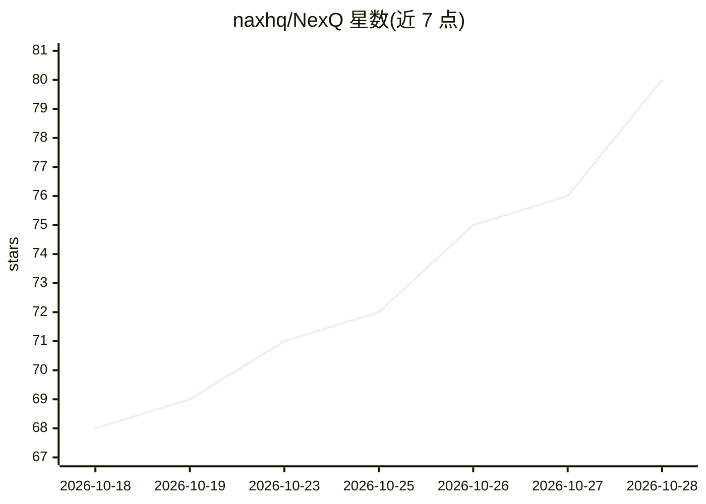

# naxhq/NexQ

⭐ 80 · TypeScript · MIT · 推送 2026-10-26 · [GitHub](https://github.com/naxhq/NexQ) · [官网](https://naxhq.github.io/NexQ/) · 个人维护

**本地优先的开源 AI 会议助手与实时面试副驾驶（桌面端）**

基于 Tauri 2（Rust 后端 + React 18 前端）的 Windows/macOS 桌面应用，提供双方独立流的实时转写、基于本地 RAG（PDF/DOCX/TXT/MD，SQLite FTS + embeddings）的即时 AI 回答、实时翻译、会议记录与回放。支持 10 个 STT 引擎与 9 个 LLM 提供商，可全离线运行（Whisper/Parakeet/Ollama），API key 存于系统凭据库；含对屏幕共享不可见的 Stealth Mode。macOS 版为 beta 且未公证，需手动清除隔离属性。

## 筛选速览

| 维度 | 判定 | 备注 |
|---|---|---|
| AI 角色 | `ai-native` | 本体是模型或模型工具 |
| 许可风险 | `permissive` | MIT |
| 部署形态 | `desktop` | 安装包/桌面程序 |
| 模型依赖 | local-ok | 支持本地模型 |
| 硬件要求 | — | 无带数字的原话,不猜 |
| 安装摩擦 | `medium` | 含编译或系统依赖之一 |
| 成熟度 | `idea` | |

## 能力要点

- 双独立音频流（本机麦克风 + 系统音频）实时转写，各配独立引擎
- 10 个 STT 引擎 + 9 个 LLM 提供商，支持全离线模式（Whisper/Parakeet/Ollama/OPUS-MT）
- 本地 RAG：基于自有文档生成有据回答（SQLite FTS + embeddings）
- Stealth Mode 使悬浮窗不进入屏幕共享与录制；无遥测，更新经 Ed25519 签名验证

## 适用场景

- 线上会议/面试中实时看到转写与 AI 建议且对方不知情
- 面试/口试场景基于简历与笔记即时生成答案建议
- 离线环境下做隐私敏感的会议转写与总结

## 场景标签

`语音识别` `RAG` `AI 助手` · 领域:对话与助手

## 证据(README 行号)

> L5: **The open-source, local-first AI meeting assistant and real-time interview copilot.**
> L32: - **Local-first and private.** Audio is captured on your machine, and you choose where it goes: fully offline engin
> L34: - **Bring your own models.** 10 speech-to-text engines and 9 LLM providers, from local Whisper and Ollama to Deepgr

## 星数曲线

2026-10-18 68 → 2026-10-28 80（+12）

---
*卡片 v1 · prompt 1.4 · 生成 2026-10-24 · 置信度 high · 依据 README sha `1137e2240cbf` · [字段定义](../../DATASET.md)*
