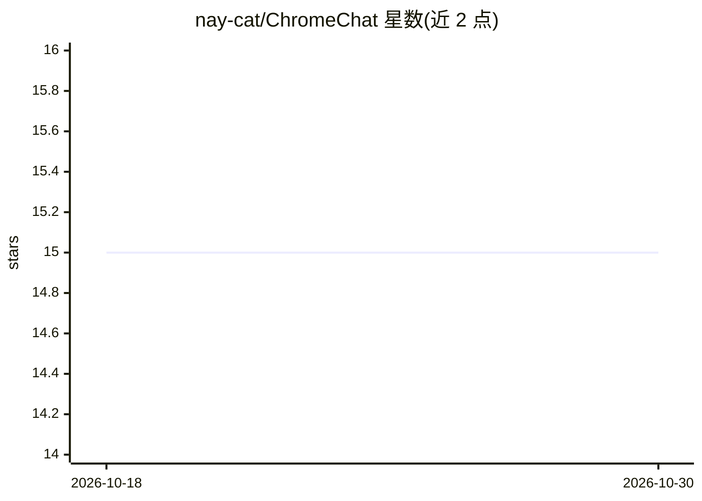

# nay-cat/ChromeChat

⭐ 15 · JavaScript · 推送 2026-05-22 · [GitHub](https://github.com/nay-cat/ChromeChat) · [官网](https://nay-cat.github.io/ChromeChat/) · 个人维护

**浏览器内离线聊天 PWA：调用 Chrome 内置 Gemini Nano，无需服务器或 API key**

以 PWA 形式运行的聊天应用，通过 Chrome 的 Prompt API 调用浏览器内置的 Gemini Nano 模型（Edge 下自动适配其内置 Phi-4），首次联网下载约 4GB 模型后可完全离线使用。数据全部存于本地：LocalStorage 保存聊天记录（上限 5MB，满时自动删除最旧记录），IndexedDB 存储文件附件，支持图片/PDF/文本附件、聊天导入导出、Markdown 渲染与系统提示词自定义。要求 Chrome 148+ 并手动开启实验性 flag。

## 筛选速览

| 维度 | 判定 | 备注 |
|---|---|---|
| AI 角色 | `ai-native` | 本体是模型或模型工具 |
| 许可风险 | `none` | — |
| 部署形态 | `None` |  |
| 模型依赖 | — | README 未给出锁定关系 |
| 硬件要求 | — | 无带数字的原话,不猜 |
| 安装摩擦 | `low` | 无编译、无系统依赖或容器化 |
| 成熟度 | — | 结构信号不足 |

## 能力要点

- 通过 Chrome Prompt API 使用内置 Gemini Nano，Edge 下自动适配 Phi-4
- 模型下载后完全离线运行，无服务器、无 API key
- 聊天记录与附件均存本地（LocalStorage/IndexedDB），附件可打包进 .crchat 导出文件
- 支持文件附件、Markdown 语法高亮、自定义系统提示词

## 适用场景

- 在没有网络的设备上使用本地模型聊天
- 不希望聊天数据上传服务器的本地对话
- 在浏览器中体验 Chrome 内置 AI 模型的能力

## 场景标签

`聊天机器人` · 领域:对话与助手

## 证据(README 行号)

> L3: Offline PWA chat powered by Chrome's built-in Gemini Nano (Prompt API) and Microsoft Edge's Phi-4. No server, no API
> L17: - Runs fully **offline** after the model is downloaded (~4 GB, one-time)

## 星数曲线

2026-10-18 15 → 2026-10-30 15（+0）

---
*卡片 v1 · prompt 1.4 · 生成 2026-10-30 · 置信度 high · 依据 README sha `fcbab5846c8e` · [字段定义](../../DATASET.md)*
