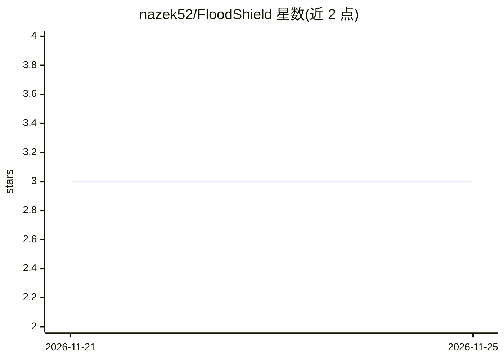

# nazek52/FloodShield

⭐ 3 · JavaScript · NOASSERTION · 推送 2026-11-10 · [GitHub](https://github.com/nazek52/FloodShield) · [官网](https://nazek52.github.io/FloodShield/) · 个人维护

**洪水现场报告 AI 抽取与情景分析研究原型**

Meta 全球 AI 开发者黑客松产出的研究原型，结合径流情景模拟、历史洪水证据与模型辅助的现场报告审阅。服务端通过 Meta API 从现场记录中抽取带原文出处的观测，经校验与人工确认后更新工作清单；静态浏览器版提供模拟、历史地图与手动审阅。README 明确声明这不是可运行的洪水预报或应急预警系统，模型输出与合成数据、真实 Copernicus 数据有明确区分。

## 筛选速览

| 维度 | 判定 | 备注 |
|---|---|---|
| AI 角色 | `ai-enhanced` | 去掉 AI 部分产品仍成立 |
| 许可风险 | `none` | NOASSERTION |
| 部署形态 | `None` |  |
| 模型依赖 | — | README 未给出锁定关系 |
| 硬件要求 | — | 无带数字的原话,不猜 |
| 安装摩擦 | `low` | 无编译、无系统依赖或容器化 |
| 成熟度 | `idea` | |

## 能力要点

- Meta API 抽取带原文引用的观测，含 schema 校验、引用检查与 4096 token 上限
- 无 Meta 服务时回退到人工审阅，不伪造模型响应
- 1 公顷栅格的简化水文求解器，0–100 检查指数与排水清理反事实对比
- 证据包导出包含输入、水平衡、审阅报告与数据出处

## 适用场景

- 现场报告的半自动抽取与人工确认审阅流程
- 合成排水情景下的干预措施反事实比较
- 历史洪水证据（Copernicus 几何）的可视化浏览

## 场景标签

`文档解析` `数据分析` · 领域:效率与自动化

## 证据(README 行号)

> L5: A research prototype combining runoff scenarios, historical flood evidence, and model-assisted field-report review. 
> L7: Developed as a Meta Global AI Developer Hackathon research prototype. It is not an operational flood forecast or eme
> L17: The GitHub Pages demo runs the simulation, historical map, guided tour and manual review in your browser. Live Meta

## 星数曲线

2026-11-21 3 → 2026-11-25 3（+0）

---
*卡片 v1 · prompt 1.4 · 生成 2026-11-21 · 置信度 mid · 依据 README sha `2ae03ddb8470` · [字段定义](../../DATASET.md)*
