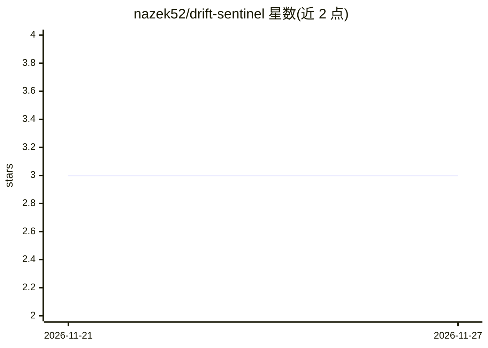

# nazek52/drift-sentinel

⭐ 3 · Python · MIT · 推送 2026-11-10 · [GitHub](https://github.com/nazek52/drift-sentinel) · 个人维护

**事件升级场景的可复现延迟标签评估与漂移诊断工具**

面向事件升级（incident escalation）任务的模型监控实验工具：按时间顺序切分数据（60/20/20），处理延迟到达的标签（未成熟标签不参与评估、单独报告），与先验基线比较，并用 PSI 检查训练/测试分布偏移。输出 report.json（指标、延迟标签计数、bootstrap 区间）、无 pickle 的可移植模型参数、预测 CSV、切分清单与可复现的合成输入。支持用自有 CSV 数据按同一协议评估；PSI 阈值仅为调查启发信号，不触发自动重训练或部署。个人 AI 辅助工程项目，MIT 许可。

## 筛选速览

| 维度 | 判定 | 备注 |
|---|---|---|
| AI 角色 | `ai-native` | 本体是模型或模型工具 |
| 许可风险 | `permissive` | MIT |
| 部署形态 | `library` | 以包/库形式分发 |
| 模型依赖 | — | README 未给出锁定关系 |
| 硬件要求 | — | 无带数字的原话,不猜 |
| 安装摩擦 | `low` | 无编译、无系统依赖或容器化 |
| 成熟度 | — | 结构信号不足 |

## 能力要点

- 时间顺序切分与延迟标签（immature label）处理协议
- PSI 分布漂移检查含缺失值与超出支持范围行为
- 输出无 pickle 的可移植模型文件与逐决策行级清单
- 固定种子 bootstrap 区间；单类测试数据时排序指标输出 null 而非编造结果

## 适用场景

- 标签延迟到达的事件升级预测模型做可复现评估
- 检查模型上线前后特征分布是否发生偏移
- 需要留出不可触碰测试集并核对未成熟标签计数的监控实验

## 场景标签

`MLOps` `模型评测` · 领域:评测与运维

## 证据(README 行号)

> L5: A reproducible model-monitoring experiment for incident escalation. Evaluate on chronological splits, account for de
> L29: |`report.json`|Model/baseline metrics, delayed-label counts, PSI, bootstrap interval, limitations|
> L31: |`predictions.csv`|Test-window probabilities; immature labels remain blank|

## 星数曲线

2026-11-21 3 → 2026-11-27 3（+0）

---
*卡片 v1 · prompt 1.4 · 生成 2026-11-21 · 置信度 high · 依据 README sha `9a592bc58b0e` · [字段定义](../../DATASET.md)*
