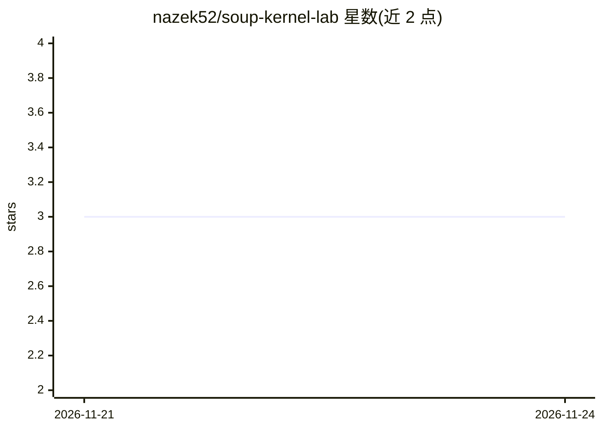

# nazek52/soup-kernel-lab

⭐ 3 · Python · Apache-2.0 · 推送 2026-11-10 · [GitHub](https://github.com/nazek52/soup-kernel-lab) · 个人维护

**面向 LLM 训练的自研 Triton RMSNorm/cross-entropy 内核与验证工具**

围绕语言模型训练优化的独立项目：自行实现 Triton 的 RMSNorm 与 cross-entropy 内核（含 forward/backward 与 autograd 集成），提供数学原型与实现之间的 loss/梯度误差校验、20 个 CPU 测试、Triton interpreter 测试及可复现的 CPU 报告（HTML/JSON/SHA-256 清单）。提供 CLI demo、pytest/ruff 检查入口，以及 Kaggle T4 上对 Qwen2.5-1.5B-Instruct（NF4+LoRA）做完整训练基准的 notebook。GPU 性能与适配器质量未被测量，竞赛投稿未声明；面向参加内核优化类任务的开发者。

## 筛选速览

| 维度 | 判定 | 备注 |
|---|---|---|
| AI 角色 | `ai-ecosystem` | LLM/agent 周边工具 |
| 许可风险 | `permissive` | Apache-2.0 |
| 部署形态 | `desktop` | 安装包/桌面程序 |
| 模型依赖 | — | README 未给出锁定关系 |
| 硬件要求 | — | 无带数字的原话,不猜 |
| 安装摩擦 | `medium` | 含编译或系统依赖之一 |
| 成熟度 | — | 结构信号不足 |

## 能力要点

- 自研 Triton 内核：ce_tile_lse、ce_row_loss、ce_tile_backward、rms_forward/rms_backward
- 20 个 CPU 测试与 Triton interpreter 测试校验算术正确性
- 可复现 CPU 报告：index.html、result.json 与 SHA-256 manifest
- Kaggle T4 notebook 固定任务（Soup 0.77.0、Qwen2.5-1.5B、NF4、LoRA rank 16）

## 适用场景

- 验证自写 Triton 内核的 loss/梯度数值正确性
- 在 Kaggle T4 上复现固定的 LLM 微调基准
- 学习 cross-entropy 分块与 RMSNorm 反向的实现方式

## 场景标签

`微调` · 领域:训练与推理

## 证据(README 行号)

> L5: Самостоятельный проект по оптимизации обучения языковой модели: собственные Triton-ядра **RMSNorm и cross-entropy**,
> L120: Задача фиксирована: Soup 0.77.0, Qwen2.5-1.5B-Instruct, NF4, LoRA rank 16,

## 星数曲线

2026-11-21 3 → 2026-11-24 3（+0）

---
*卡片 v1 · prompt 1.4 · 生成 2026-11-21 · 置信度 high · 依据 README sha `7a1a7a8ea374` · [字段定义](../../DATASET.md)*
