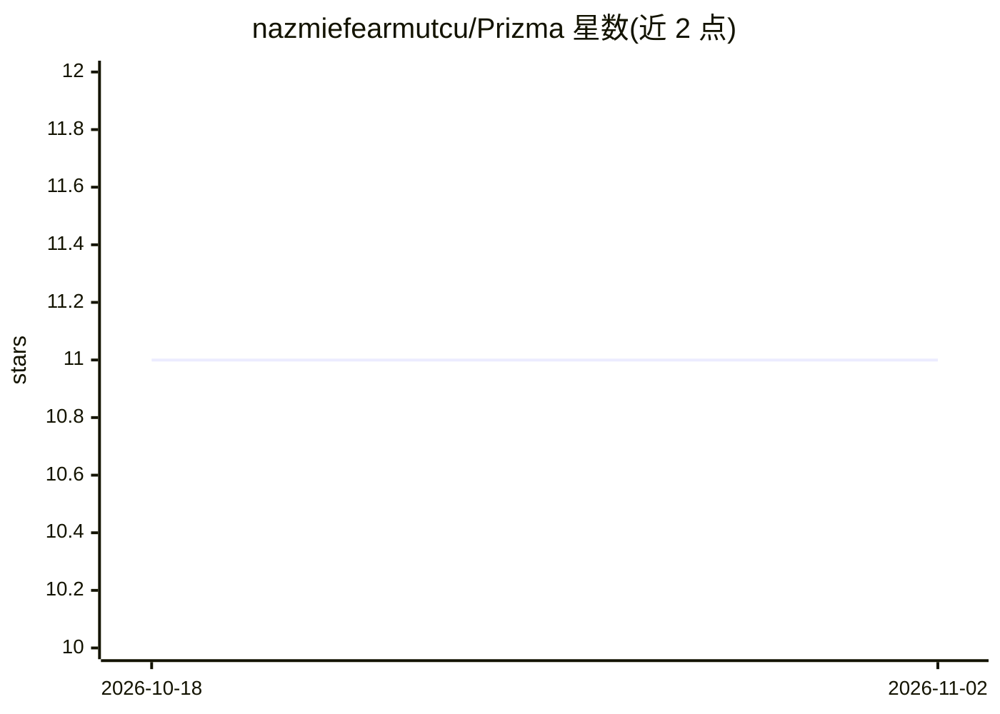

# nazmiefearmutcu/Prizma

⭐ 11 · Python · Apache-2.0 · 推送 2026-10-30 · [GitHub](https://github.com/nazmiefearmutcu/Prizma) · 个人维护

**本地持续学习与循环序列模型的研究代码库**

面向科研复现的小规模实验代码库：含两条研究线——基于 NumPy 预测编码专家与惊喜路由的无反向传播持续学习器，以及基于 PyTorch 的 delta 状态混合器与固定大小循环状态的序列模型；另有将两者结合的持续语言模型实验。提供实验运行器、预注册协议、原始结果记录与已记录的局限（如受污染活动被隔离、大规模对比无已提交结果）。CPU 测试环境用 Python 3.11/3.12，依赖 NumPy、PyTorch、Matplotlib。

## 筛选速览

| 维度 | 判定 | 备注 |
|---|---|---|
| AI 角色 | `ai-native` | 本体是模型或模型工具 |
| 许可风险 | `permissive` | Apache-2.0 |
| 部署形态 | `library` | 以包/库形式分发 |
| 模型依赖 | — | README 未给出锁定关系 |
| 硬件要求 | — | 无带数字的原话,不猜 |
| 安装摩擦 | `low` | 无编译、无系统依赖或容器化 |
| 成熟度 | — | 结构信号不足 |

## 能力要点

- 无反向传播的本地持续学习器（NumPy 预测编码专家、惊喜路由）
- 固定大小循环状态的序列模型（门控 delta 规则、局部注意力窗口）
- 预注册协议与原始结果记录，含隔离声明与局限文档
- 提供 CPU 与 GPU 实验运行器

## 适用场景

- 复现和检视小规模持续学习与序列建模实验
- 研究任务无关的增量领域学习与专家路由机制
- 作为持续语言建模的对照基线实验代码

## 场景标签

`科研工具` · 领域:学习与行业

## 证据(README 行号)

> L8: Research code for local continual learning and recurrent sequence modeling. Prizma includes model implementations, c
> L14: |**Prizma**|Learning successive, distinguishable domains without receiving task labels or task boundaries|NumPy pre
> L15: |**Prizma-Seq**|Associative recall and language modeling with a fixed-size recurrent state|PyTorch delta-state mixe

## 星数曲线

2026-10-18 11 → 2026-11-02 11（+0）

---
*卡片 v1 · prompt 1.4 · 生成 2026-11-01 · 置信度 mid · 依据 README sha `e5901388602f` · [字段定义](../../DATASET.md)*
