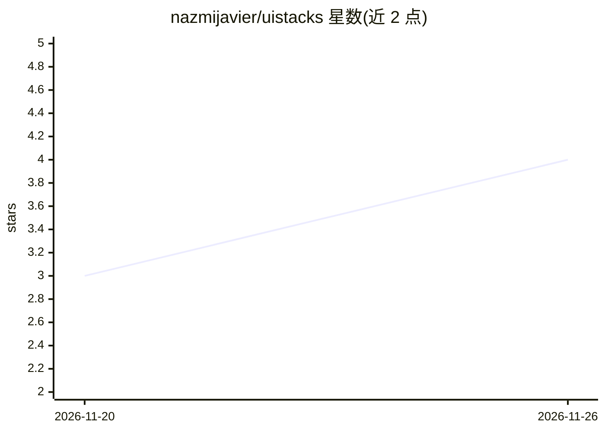

# nazmijavier/uistacks

⭐ 4 · TypeScript · MIT · 推送 2026-11-22 · [GitHub](https://github.com/nazmijavier/uistacks) · [官网](https://uistacks.dev) · 个人维护

**给 AI 聊天/Agent/仪表盘界面用的 React 动效组件库**

一个 MIT 许可的免费 React 组件集，共 71 个组件，按 AI Chat、AI Agents、表单、图表、营销等 13 个类别组织，基于 React 19、TypeScript、Tailwind CSS 4 与 Motion 构建，含明暗主题、键盘支持与读屏标签。提供 shadcn CLI 注册表安装方式，并可注册为 Claude Code 的 agent skill；其余组件、区块与完整应用模板属于收费的 UI Stacks Pro，不在此仓库内。

## 筛选速览

| 维度 | 判定 | 备注 |
|---|---|---|
| AI 角色 | `ai-enhanced` | 去掉 AI 部分产品仍成立 |
| 许可风险 | `permissive` | MIT |
| 部署形态 | `library` | 以包/库形式分发 |
| 模型依赖 | — | README 未给出锁定关系 |
| 硬件要求 | — | 无带数字的原话,不猜 |
| 安装摩擦 | `low` | 无编译、无系统依赖或容器化 |
| 成熟度 | — | 结构信号不足 |

## 能力要点

- 71 个免费 MIT 组件，含 AI Chat 消息/引用/分支切换与 Agent 审批请求等专用组件
- 支持 shadcn CLI 与 shadcn MCP server 注册表安装
- 提供 Claude Code agent skill（npx skills add）让 agent 搜索并安装组件
- 每个组件附实时预览、props、无障碍说明与 coding agent 提示词

## 适用场景

- 为 AI 聊天或 agent 产品搭建前端界面
- 用 shadcn 工作流把组件直接安装进 Next.js 项目
- 让 Claude Code/Cursor 等 agent 按提示词生成风格一致的界面

## 场景标签

 · 领域:前端/UI 组件库

## 证据(README 行号)

> L3: **UI Stacks components for AI agents.** Animated React components for AI chat and agents, dashboards and charts, che
> L5: This repository holds the 71 free components, MIT licensed. Every component has a live preview, props, accessibility
> L27: Or add the registry once to `components.json` (`"registries": { "@uistacks": "https://uistacks.dev/r/{name}.json" }

## 星数曲线

2026-11-20 3 → 2026-11-26 4（+1）

---
*卡片 v1 · prompt 1.4 · 生成 2026-11-21 · 置信度 high · 依据 README sha `9344076acd99` · [字段定义](../../DATASET.md)*
