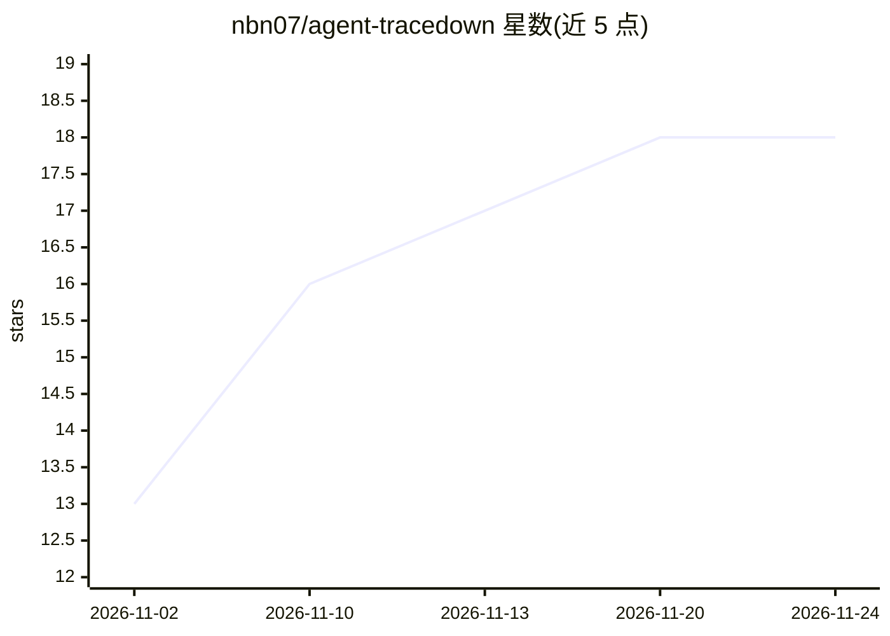

# nbn07/agent-tracedown

⭐ 18 · Python · Apache-2.0 · 推送 2026-11-13 · [GitHub](https://github.com/nbn07/agent-tracedown) · [官网](https://tracedown-demo.onrender.com/) · 个人维护

**诊断 AI agent 失败根因的工具：定位致错步骤并回放验证修复**

面向构建与运维 AI agent 的开发者：读取已有运行轨迹（Langfuse、Arize Phoenix、任意 OpenTelemetry 导出，无需改代码），从症状回溯到致错步骤，给出根因、证据与责任判定（agent 或用户），生成可粘贴的 AI stack trace；并从断点处带修复回放运行、重复三次验证修复有效。诊断以规则优先、可不依赖 LLM，可选低成本 LLM judge 提升准确率。提供 Python/TypeScript SDK（零依赖）与自托管服务器，一行代码接入 13 个框架；单进程 SQLite 起步，可扩展到 Postgres/ClickHouse/Kafka 部署。限制：回放需用 SDK 记录的运行；在公开 Who&When 基准上首猜准确率 42.9%（带 judge），作者提示首猜错误概率仍高于正确。

## 筛选速览

| 维度 | 判定 | 备注 |
|---|---|---|
| AI 角色 | `ai-ecosystem` | LLM/agent 周边工具 |
| 许可风险 | `permissive` | Apache-2.0 |
| 部署形态 | `self-host` | docker 或自建部署 |
| 模型依赖 | — | README 未给出锁定关系 |
| 硬件要求 | — | 无带数字的原话,不猜 |
| 安装摩擦 | `low` | 无编译、无系统依赖或容器化 |
| 成熟度 | — | 结构信号不足 |

## 能力要点

- 从症状回溯致错步骤，输出根因、证据与责任判定
- 从断点带修复回放运行并三次验证（tdn.try_fixes，检查期间工具不真实执行）
- 诊断规则优先、无需 LLM 即可运行，LLM judge 可选
- 导入 Langfuse/Phoenix/OTLP 既有轨迹无需改代码；13 框架一行接入

## 适用场景

- 客服 agent 给出错误金额时定位是哪一步的过期文档导致
- agent 静默失败（日期格式错误、过期检索、循环烧调用）后拿到可粘贴 issue 的失败堆栈
- 在部署修复前回放验证问题消失且无新问题
- 把失败按根因聚合成事件并接入 Slack/PagerDuty/GitHub 告警

## 场景标签

`LLM 可观测性` · 领域:评测与运维

## 证据(README 行号)

> L27: - **Works with what you have.** Import failed runs from Langfuse, Arize Phoenix or any OpenTelemetry exporter with 
> L31: - **Runs without an LLM.** Diagnosis is rules first: instant, free and private. An inexpensive LLM judge is optiona

## 星数曲线

2026-11-02 13 → 2026-11-24 18（+5）

---
*卡片 v1 · prompt 1.4 · 生成 2026-11-18 · 置信度 high · 依据 README sha `8ac4dd3311ad` · [字段定义](../../DATASET.md)*
