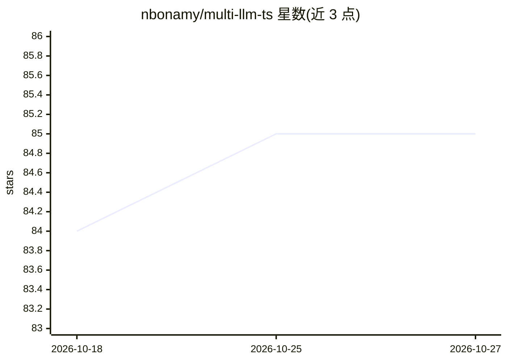

# nbonamy/multi-llm-ts

⭐ 85 · TypeScript · Apache-2.0 · 推送 2026-10-17 · [GitHub](https://github.com/nbonamy/multi-llm-ts) · [官网](https://nbonamy.github.io/multi-llm-ts) · 个人维护

**统一调用多家 LLM 提供商 API 的 TypeScript 库**

TypeScript 库，为 12 家 LLM 提供商（Anthropic、Azure AI、Cerebras、DeepSeek、Google、Groq、Meta/Llama、MistralAI、Ollama、OpenAI、OpenRouter、xAI）提供统一 API：单一接口、流式输出、函数调用、视觉输入、基于 Zod 的结构化输出、多轮对话、操作中止与 token 用量报告。面向构建聊天应用的 TypeScript 开发者，通过 npm 安装，附示例工程，MIT 许可。

## 筛选速览

| 维度 | 判定 | 备注 |
|---|---|---|
| AI 角色 | `ai-ecosystem` | LLM/agent 周边工具 |
| 许可风险 | `permissive` | Apache-2.0 |
| 部署形态 | `library` | 以包/库形式分发 |
| 模型依赖 | local-ok | 支持本地模型 |
| 硬件要求 | — | 无带数字的原话,不猜 |
| 安装摩擦 | `low` | 无编译、无系统依赖或容器化 |
| 成熟度 | — | 结构信号不足 |

## 能力要点

- 单一接口覆盖 12 家 LLM 提供商
- 流式输出、函数调用、视觉输入、多轮对话
- Zod schema 类型安全的结构化 JSON 输出
- token 用量报告与操作中止支持

## 适用场景

- 在 TypeScript 项目中用统一接口切换多家 LLM 提供商
- 构建带函数调用与流式输出的聊天应用
- 获取类型安全的结构化 JSON 响应并跟踪 token 消耗

## 场景标签

`模型网关` · 领域:Agent 开发

## 证据(README 行号)

> L3: A TypeScript library to use LLM provider APIs in a unified way.
> L33: ## Supported Providers

## 星数曲线

2026-10-18 84 → 2026-10-27 85（+1）

---
*卡片 v1 · prompt 1.4 · 生成 2026-10-24 · 置信度 high · 依据 README sha `ff5c9157bfde` · [字段定义](../../DATASET.md)*
