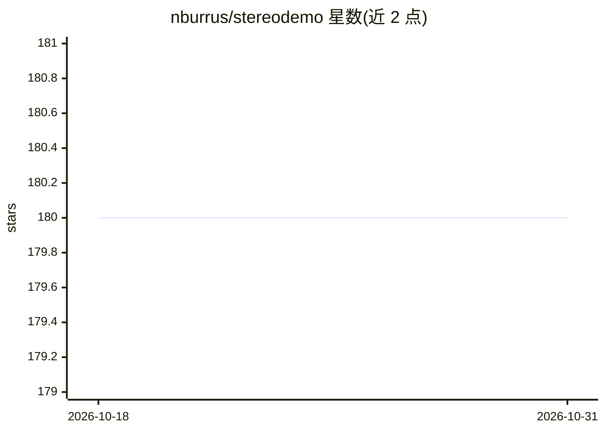

# nburrus/stereodemo

⭐ 180 · Python · MIT · 推送 2026-10-25 · [GitHub](https://github.com/nburrus/stereodemo) · 个人维护

**比较和可视化多种立体深度估计算法输出的 Python 工具**

供研究者与工程师使用的 Python 命令行/图形工具：内置 10 种立体与单目深度估计算法（OpenCV 块匹配基线、CREStereo、RAFT-Stereo、Hitnet、STTR、RealtimeStereo、DistDepth、Depth Anything V3、DUSt3R），均复用各自作者的预训练模型并转换为 torch script/ONNX 运行。支持输入左右图像对或从 OAK-D 相机实时采集，提供彩色点云交互视图与同一图像上调整参数的能力，内置多个数据集样例图。限制：DUSt3R 权重约 2.3GB 且 CC BY-NC-SA 4.0 非商业许可；STTR 导出模型仅支持 CPU 推理。

## 筛选速览

| 维度 | 判定 | 备注 |
|---|---|---|
| AI 角色 | `ai-native` | 本体是模型或模型工具 |
| 许可风险 | `permissive` | MIT |
| 部署形态 | `library` | 以包/库形式分发 |
| 模型依赖 | — | README 未给出锁定关系 |
| 硬件要求 | — | 无带数字的原话,不猜 |
| 安装摩擦 | `low` | 无编译、无系统依赖或容器化 |
| 成熟度 | — | 结构信号不足 |

## 能力要点

- 内置 10 种深度估计算法的预训练模型（torch script/ONNX 转换）
- 交互式彩色点云可视化，同一图像上调整参数
- 支持 OAK-D 相机实时采集与常见数据集样例图
- 通过 pip 安装，依赖（Open3D/OpenCV/onnxruntime/pytorch）自动安装

## 适用场景

- 在真实场景图像上定性比较多个深度估计算法的输出
- 用 OAK-D 相机现场采集并查看点云结果
- 调整块匹配等算法参数观察效果差异

## 场景标签

 · 领域:计算机视觉/3D 重建

## 证据(README 行号)

> L8: Small Python utility to **compare and visualize** the output of various **stereo depth estimation** algorithms:
> L10: - Make it easy to get a qualitative evaluation of several state-of-the-art models in the wild

## 星数曲线

2026-10-18 180 → 2026-10-31 180（+0）

---
*卡片 v1 · prompt 1.4 · 生成 2026-10-22 · 置信度 high · 依据 README sha `6232c7dd3d2a` · [字段定义](../../DATASET.md)*
