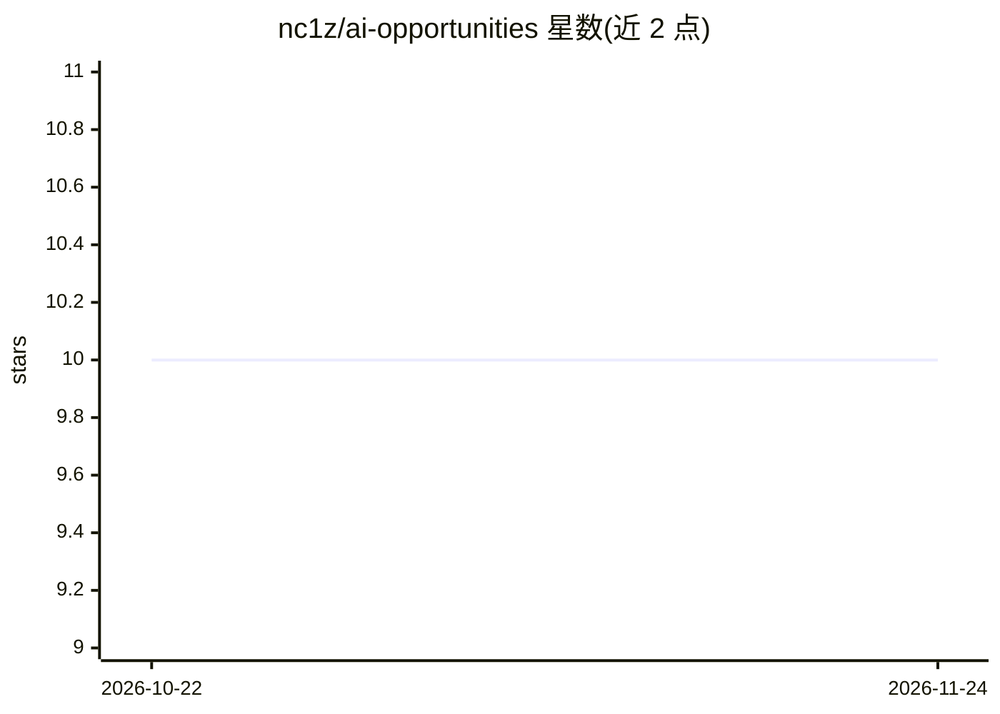

# nc1z/ai-opportunities

⭐ 10 · TypeScript · MIT · 推送 2026-04-16 · [GitHub](https://github.com/nc1z/ai-opportunities) · [官网](https://nc1z.github.io/ai-opportunities/) · 个人维护

**AI 生态机会的五层结构化行业扫描站点**

对 AI 生态的结构化行业扫描，将多数开发者实际活动的领域组织为五层分类体系：应用层、Agent 与工作流层、Harness 与运行时层、开发者工具层、模型消费层；有意排除计算、半导体与基础模型训练等深层基础设施。分类体系通过五个 AI 研究 agent 的多步深度研究流程生成，按来源一致数交叉验证后合并。以静态站点形式发布（GitHub Pages），可用 pnpm 本地运行。

## 筛选速览

| 维度 | 判定 | 备注 |
|---|---|---|
| AI 角色 | `ai-knowledge` | 知识聚合/清单类 |
| 许可风险 | `permissive` | MIT |
| 部署形态 | `library` | 以包/库形式分发 |
| 模型依赖 | — | README 未给出锁定关系 |
| 硬件要求 | — | 无带数字的原话,不猜 |
| 安装摩擦 | `low` | 无编译、无系统依赖或容器化 |
| 成熟度 | — | 结构信号不足 |

## 能力要点

- 五层 AI 栈分类体系（应用/Agent/运行时/开发工具/模型消费）
- 五个 AI 研究 agent 独立分析并按来源一致数交叉验证的方法论
- 提供 GitHub Pages 在线版本
- pnpm 本地开发与构建流程

## 适用场景

- 了解 AI 生态各层正在构建什么、缺口在哪里
- 在规划 AI 创业或贡献方向前做整体定位
- 查阅模型消费层的接入、路由与优化方式分类

## 场景标签

`精选清单` · 领域:学习与行业

## 证据(README 行号)

> L3: An industry scan of the AI ecosystem — a structured overview of where the field stands, what's being built, and wher
> L21: The taxonomy was built through a structured multi-agent deep research process. Five AI research agents were indepen

## 星数曲线

2026-10-22 10 → 2026-11-24 10（+0）

---
*卡片 v1 · prompt 1.4 · 生成 2026-11-19 · 置信度 mid · 依据 README sha `9d425ca6ebd1` · [字段定义](../../DATASET.md)*
